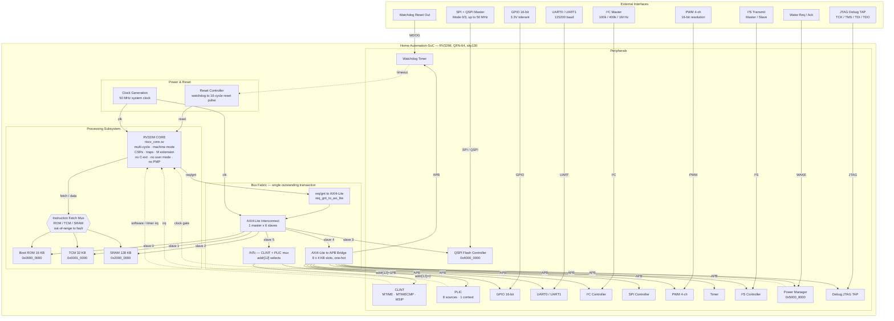
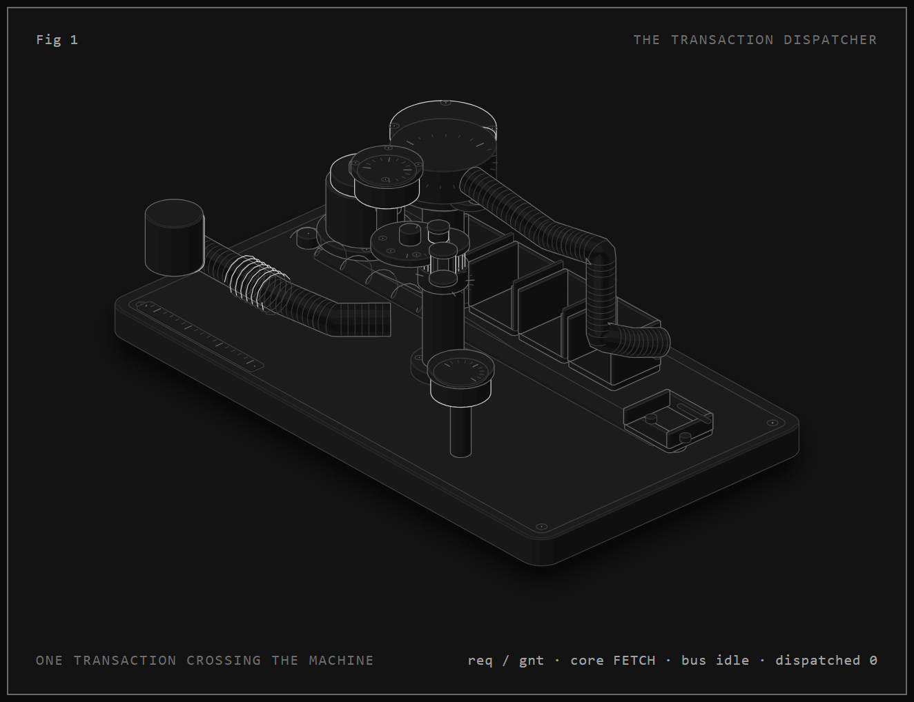
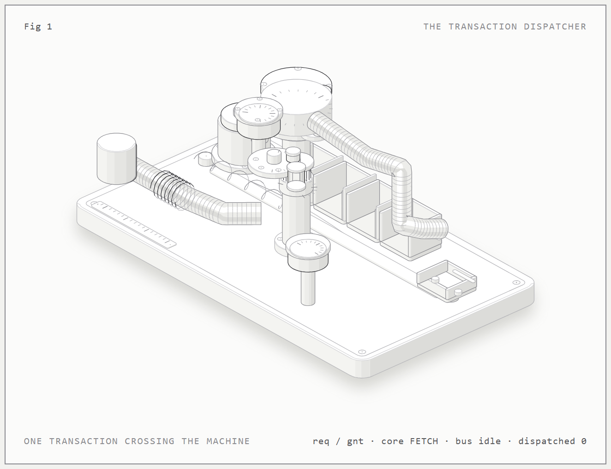

# Home-Automation-SoC

[](https://github.com/RAMA-L7/Home-Automation-SoC)
[](https://github.com/RAMA-L7/Home-Automation-SoC/tree/main/rtl)
[](https://github.com/RAMA-L7/Home-Automation-SoC/tree/main/firmware)
[](https://github.com/RAMA-L7/Home-Automation-SoC/tree/main/sim)
[](https://github.com/RAMA-L7/Home-Automation-SoC/tree/main/fpga)
[](https://github.com/RAMA-L7/Home-Automation-SoC/tree/main/asic)
[](LICENSE)

***

## 📋 Project Overview

**Home-Automation-SoC** is a semiconductor engineering project delivering a low-power residential home automation System-on-Chip (SoC) in SystemVerilog RTL with bare-metal firmware, verification testbenches, FPGA constraints, ASIC physical-design flow scripts, and PCB documentation.

**Target Applications:** Smart home hubs, sensor nodes, actuator controllers, IoT gateways\
**External Host:** Home Assistant + Claude-based voice assistant (off-chip)\
**Package Target:** QFN-64\
**Process Target:** SkyWater 130nm (sky130A)\
**FPGA Target:** Digilent Nexys A7-100T (Artix-7 XC7A100TCSG324-1)

### 🔍 Search Keywords

`RISC-V`, `RV32IMC`, `SoC`, `SystemVerilog`, `AXI4-Lite`, `APB`, `GPIO`, `UART`, `I2C`, `SPI`, `PWM`, `I2S`, `QSPI`, `CLINT`, `PLIC`, `Watchdog`, `Timer`, `Boot ROM`, `SRAM`, `TCM`, `Secure Boot`, `Home Automation`, `Home Assistant`, `SkyWater 130nm`, `sky130`, `Nexys A7`, `Artix-7`, `Vivado`, `OpenLane 2`, `OpenROAD`, `Yosys`, `Icarus Verilog`, `Verilator`, `cocotb`, `KiCad`, `PCB`, `QFN-64`, `Mermaid`, `block diagram`, `ASIC`, `FPGA`, `EDA`, `RTL`, `firmware`, `verification`, `regression`, `SVA`, `formal verification`, `CDC`, `reset controller`, `watchdog`, `UART`, `pin-level`, `ISA trap`, `interrupt controller`, `power manager`, `clock gating`

***

## 🏗️ System Block Diagram (Mermaid)

> **An animated figure of the same system is in** **[`docs/figures/dispatcher/dispatcher.html`](docs/figures/dispatcher/dispatcher.html)** — open it in a browser. It shows one transaction crossing the machine: in at the peripheral port, up the bus fabric, decoded by the address drum, and out to memory or a peripheral, with the core stepping through fetch → execute → memory as it goes.

<!-- BEGIN MERMAID BLOCK DIAGRAM -->

<!-- Source of truth: docs/architecture/BLOCK_DIAGRAM.md -->

<!-- Regenerate with: python scripts/docs/sync_readme_mermaid.py -->



<!-- END MERMAID BLOCK DIAGRAM -->

### ASCII Block Diagram

<!-- BEGIN GENERATED BLOCK DIAGRAM -->

<!-- Generated by scripts/docs/gen_block_diagram.py - do not edit by hand -->

<!-- Source of truth: rtl/rtl_top/has_soc.sv, has_addr_map.sv, intc_axi.sv -->

```text
┌────────────────────────────────────────────────────────────────────────────────────────────────────────────────────────────────┐
│  HOME-AUTOMATION-SOC   ·   QFN-64   ·   SkyWater 130 nm (sky130)   ·   RV32IM                                                  │
│  50 MHz core clock   ·   AXI4-Lite bus fabric   ·   APB peripherals   ·   < 1 mW deep sleep                                    │
└────────────────────────────────────────────────────────────────────────────────────────────────────────────────────────────────┘

EXTERNAL PINS
       │        │       │         │            │            │        │       │         │         │
     UART0    UART1    I2C    SPI/QSPI    GPIO[15:0]    PWM[3:0]    I2S    JTAG    WDOG rst    WAKE
       ▼        ▼       ▼         ▼            ▼            ▼        ▼       ▼         ▼         ▼

┌────────────────────────────────────────────────────────────────────────────────────────────────────────────────────────────────┐
│  HOME-AUTOMATION-SOC                                                                                                           │
│                                                                                                                                │
│                                                                                                                                │
│  ┌──────────────────────────────────────────────────┐  BUS FABRIC                        ┌────────────────────────────────────┐│
│  │ PROCESSING SUBSYSTEM                             │  one outstanding transaction       │ PERIPHERALS                        ││
│  │ instruction fetch + data access                  │                                    │ APB map  0x5000_0000               ││
│  │                                                  │   ┌───────────────────────────┐    │                                    ││
│  │ RV32IM CORE   riscv_core.sv                      │   │ req/gnt → AXI4-Lite       │    │ GPIO[15:0]      0x5000_0000        ││
│  │ multi-cycle · machine mode                       │   │ req_gnt_to_axi_lite       │    │ UART0 / UART1   0x5000_1000        ││
│  │ CSRs · synchronous traps · M extension           │◄► │                           │    │ I2C master      0x5000_2000        ││
│  │ no C-ext · no user mode · no PMP                 │   └───────────────────────────┘    │ SPI master      0x5000_3000        ││
│  │ 4-state FSM: FETCH → EXEC → MEM / TRAP           │                                    │ PWM 4-ch        0x5000_4000        ││
│  │                                                  │   ┌───────────────────────────┐    │ Timer           0x5000_5000        ││
│  │ instruction fetch mux                            │   │ AXI4-Lite INTERCONNECT    │    │ Watchdog        0x5000_6000        ││
│  │ ROM / TCM / SRAM, out-of-range → fault           │   │ 1 master × 6 slaves       │    │ I2S             0x5000_7000        ││
│  │ ┌─────────────┐ ┌─────────────┐ ┌─────────────┐  │   │                           │    │ Power manager   0x5000_8000        ││
│  │ │ BOOT ROM    │ │ TCM         │ │ SRAM        │  │   └───────────────────────────┘    │                                    ││
│  │ │ 16 KB       │ │ 32 KB       │ │ 128 KB      │  │                                    │ QSPI flash ctrl  0x4000_0000       ││
│  │ │ 0x0000_0000 │ │ 0x0001_0000 │ │ 0x2000_0000 │  │   ┌───────────────────────────┐    │ Debug JTAG TAP   on-chip           ││
│  │ │ exec + data │ │ exec + data │ │ exec + data │  │   │ AXI4-Lite → APB bridge    │    └────────────────────────────────────┘│
│  │ └─────────────┘ └─────────────┘ └─────────────┘  │   │ 9 × 4 KB slots, one-hot   │                                          │
│  │                                                  │   │                           │                                          │
│  └──────────────────────────────────────────────────┘   └───────────────────────────┘                                          │
│                                                                                                                                │
│                                                         ┌───────────────────────────┐    ┌────────────────────────────────────┐│
│                                                         │ INTc  CLINT + PLIC        │    │ POWER & RESET                      ││
│                                                         │ 0x8000_0000 / 0x8000_1000 │    │ reset_ctrl · clock gating · sleep  ││
│                                                         │                           │    │ watchdog → 16-cycle reset pulse    ││
│                                                         └───────────────────────────┘    └────────────────────────────────────┘│
│                                                                                                                                │
│                                                                                                                                │
│                                                                                                                                │
│                                                                                                                                │
│                                                                                                                                │
│                                                                                                                                │
│                                                                                                                                │
│                                                                                                                                │
│                                                                                                                                │
└────────────────────────────────────────────────────────────────────────────────────────────────────────────────────────────────┘


MEMORY MAP
   0x0000_0000  16 KB  Boot ROM     0x0001_0000  32 KB  TCM     0x2000_0000  128 KB  SRAM     0x4000_0000  64 MB  QSPI flash

INTERRUPTS  CLINT: software + timer      PLIC: 8 sources, 1 context, 7-bit priority
VERIFIED    Regression PASS 17/17 (Icarus)   ·   full-SoC boot 7/7 (Verilator C++ model)
NOT YET     Secure boot · OTA signing · flash program/erase · retention · deep-sleep gating
```

<!-- END GENERATED BLOCK DIAGRAM -->

### Animated Figure

<table>
<tr>
<td><a href="docs/figures/dispatcher/dispatcher.html"></a></td>
<td><a href="docs/figures/dispatcher/dispatcher-light.html"></a></td>
</tr>
<tr>
<td align="center"><sub>Dark theme — <a href="docs/figures/dispatcher/dispatcher.html">open the animation</a></sub></td>
<td align="center"><sub>Light theme — <a href="docs/figures/dispatcher/dispatcher-light.html">open the animation</a></sub></td>
</tr>
</table>

**Fig 1 — The transaction dispatcher.** One transaction is modelled as a glass
capsule on a pneumatic dispatcher. The capsule is pushed in at the bell mouth
(the peripheral port), a vacuum line lifts it up the brass trunk (the bus
fabric), the address drum at the head turns to the slave the address selects
(one-hot decode), and the capsule either drops into one of the four
pigeonholes (Boot ROM, TCM, SRAM and the APB peripherals) or is dispatched
down the outbound tube to the chute. The lever on the left steps the core
through fetch, execute, memory and trap; the counter tallies completed
dispatches and the gauge shows bus activity.

Regenerate it with `node docs/figures/dispatcher/build.mjs` (add `--light` for
the light theme, `--force-motion` when capturing with headless Chrome, which
reports `prefers-reduced-motion: reduce`).


***

## 🛠️ Tech Stack

> **All tools live under** **`D:\tools`** (WSL: `/mnt/d/tools`). The authoritative
> inventory — exact paths, invocation commands, versions and known limitations —
> is **`D:\tools\EDA_TOOL_REGISTRY.md`**. 31 tools are verified functional
> (16 Windows + 15 WSL, 0 failures) by `D:\tools\verify_tools.bat` and
> `D:\tools\verify_tools_wsl.sh`.

### Design Stack

| Layer                | Technology             | Version        | Purpose                                             | Status                       |
| -------------------- | ---------------------- | -------------- | --------------------------------------------------- | ---------------------------- |
| **ISA**              | RISC-V RV32IM          | —              | Base + Multiply (no Compressed)                     | Implemented                  |
| **Processor Core**   | Custom `riscv_core.sv` | —              | Multi-cycle, machine mode, CSRs, traps, M-extension | Implemented                  |
| **HDL**              | SystemVerilog          | IEEE 1800-2017 | RTL design entry                                    | 23 files                     |
| **Bus (CPU↔Mem)**    | AXI4-Lite              | —              | 32-bit data, single outstanding                     | Implemented                  |
| **Bus (Peripheral)** | APB                    | —              | Via AXI4-Lite→APB bridge, 9 × 4 KB one-hot slots    | Implemented                  |
| **Firmware**         | C / Assembly           | C11 / GNU AS   | Bare-metal + boot assembly                          | Compiles, runs in sim        |
| **RTOS**             | Zephyr                 | 3.6+ LTS       | Planned                                             | Not integrated               |
| **Crypto**           | Mbed TLS PSA           | 3.5+           | Planned for secure boot / OTA                       | Not integrated               |
| **PDK**              | SkyWater 130 nm        | sky130A        | ASIC target process                                 | Downloaded (`D:\tools\pdk\`) |

### Toolchain — Simulation & Verification

| Tool                           | Version                | Platform      | Location                               | Status                                            |
| ------------------------------ | ---------------------- | ------------- | -------------------------------------- | ------------------------------------------------- |
| **Icarus Verilog**             | 14.0 (devel)           | Windows       | `D:\tools\oss-cad-suite\`              | **Working** — `iverilog` + `vvp`                  |
| **Verilator** (lint)           | 5.053 devel            | Windows       | `D:\tools\oss-cad-suite\`              | **Working** — 0 lint errors                       |
| **Verilator** (C++ sim)        | 5.053 devel            | Windows       | + `D:\tools\verilator-shim\`           | **Working** — full SoC 7/7 at \~20,000× real time |
| **MinGW-w64** (g++/ar/make)    | g++ 16.1.0, make 4.4.1 | Windows       | `D:\tools\mingw64\`                    | **Working** — use `-O2` (see registry trap 17)    |
| **Verible** (SV lint/format)   | v0.0-4298              | Windows       | `D:\tools\verible\`                    | **Working** — 11 tools                            |
| **SymbiYosys**                 | SBY v0.69              | Windows       | `D:\tools\oss-cad-suite\`              | **Working**                                       |
| **Yosys** (native)             | 0.69+154               | Windows       | `D:\tools\oss-cad-suite\`              | **Working** — core synthesises, 226 cells         |
| **Yosys** (portable/WASM)      | 0.70                   | Windows + WSL | `D:\tools\venv\`, `D:\tools\venv-wsl\` | **Working** — no compiler needed                  |
| **SymbiYosys** (portable/WASM) | SBY                    | Windows + WSL | `D:\tools\venv\`, `D:\tools\venv-wsl\` | **Working**                                       |
| **cocotb**                     | 2.1.0                  | Windows       | `D:\tools\venv\`                       | **Working**                                       |
| **pytest**                     | 9.2.0                  | Windows       | `D:\tools\venv\`                       | **Working**                                       |
| **GTKWave**                    | —                      | Windows       | `D:\tools\oss-cad-suite\`              | **Working** — waveform viewer                     |
| **OpenOCD**                    | —                      | Windows       | `D:\tools\oss-cad-suite\`              | **Working** — JTAG debug                          |

### Toolchain — ASIC Physical Design

| Tool                 | Version         | Platform      | Location                                              | Status                                        |
| -------------------- | --------------- | ------------- | ----------------------------------------------------- | --------------------------------------------- |
| **OpenLane 2**       | v2.0.0b16       | WSL           | `D:\tools\src\openlane2\`, `D:\tools\venv-openlane2\` | **CLI working** — end-to-end flow NOT\_TESTED |
| **OpenROAD**         | `bazel-nostamp` | WSL           | `D:\tools\openroad\`                                  | **Working** — 25/33 PD stages validated       |
| **OpenSTA**          | 3.1.0           | WSL           | `D:\tools\opensta\`                                   | **Working** — TT/SS/FF multi-corner           |
| **Magic**            | 8.3.105         | WSL           | `D:\tools\magic\`                                     | **Working** — layout DRC                      |
| **Netgen**           | 6.2.2401        | WSL           | `D:\tools\netgen\`                                    | **Working** — LVS comparison                  |
| **KLayout**          | 0.30.13         | WSL           | `D:\tools\KLayout\`                                   | **Working** — DRC/LVS/GDSII                   |
| **volare**           | 0.20.6          | WSL           | `D:\tools\venv-openlane2\`                            | **Working** — PDK version manager             |
| **bazelisk**         | 1.30.0          | Windows + WSL | `D:\tools\bazelisk\`                                  | **Working** — Bazel 7.4.1                     |
| **Yosys** (WSL, apt) | 0.33            | WSL           | `/usr/bin/yosys`                                      | Superseded — use the WASM 0.70 build          |

### Toolchain — FPGA & PCB

| Tool              | Version          | Platform | Location               | Status                          |
| ----------------- | ---------------- | -------- | ---------------------- | ------------------------------- |
| **KiCad**         | 10.0.8           | Windows  | `D:\tools\KiCad\10.0\` | **Working** — `kicad-cli`       |
| **Xilinx Vivado** | WebPACK          | Windows  | —                      | **Not installed** (proprietary) |
| **Nexys A7-100T** | Artix-7 XC7A100T | Hardware | —                      | **No hardware**                 |

### Toolchain — Firmware & Build

| Tool                  | Version                      | Platform      | Location                                      | Status                                    |
| --------------------- | ---------------------------- | ------------- | --------------------------------------------- | ----------------------------------------- |
| **RISC-V GCC**        | xPack 12.2.0                 | Windows       | `D:\tools\xpack-riscv-none-elf-gcc-12.2.0-2\` | **Working** — `-march=rv32im -mabi=ilp32` |
| **Python**            | 3.10.11 (Win) / 3.12.3 (WSL) | Both          | `D:\tools\venv\`, `/usr/bin/python3`          | **Working**                               |
| **Node.js**           | v26.7.0 / v22.23.4           | Windows / WSL | PATH                                          | **Working** — build + regression scripts  |
| **GNU Make**          | 4.4.1 (Win) / 4.3 (WSL)      | Both          | `D:\tools\mingw64\bin\`, `/usr/bin/make`      | **Working**                               |
| **Git**               | —                            | Both          | PATH                                          | **Working**                               |
| **GitHub CLI** (`gh`) | —                            | Windows       | PATH                                          | **Working** — authenticated as RAMA-L7    |

### Reproducing the Verification

```bash
# Icarus regression (17 testbenches)
node scripts/eda/run_regression.js

# Verilator C++ model of the full SoC
scripts/eda/verilator_build_soc.bat tb_boot sim/sim_top/tb_boot.v build/obj_soc
scripts/eda/verilator_run.bat build/obj_soc/Vtb_boot.exe

# Verible style lint over the RTL
D:\tools\verible\verible-verilog-lint.exe rtl/rtl_top/*.sv rtl/rtl_peripherals/*.sv

# Formal verification (SymbiYosys)
D:\tools\venv\Scripts\yowasp-sby.exe -f reports/verification/formal_sram.sby

# Toolchain self-check
D:\tools\verify_tools.bat
wsl -d Ubuntu-24.04 -- bash /mnt/d/tools/verify_tools_wsl.sh
```

### RTL Files (22 SystemVerilog Files)

**Top-Level / SoC Integration (`rtl/rtl_top/`):**

| File                       | Function                         | Status |
| -------------------------- | -------------------------------- | ------ |
| `has_soc.sv`               | Top-level SoC integration        | Done   |
| `has_addr_map.sv`          | Address map package              | Done   |
| `boot_rom.sv`              | 16 KB secure boot ROM            | Done   |
| `sram.sv`                  | 128 KB SRAM                      | Done   |
| `riscv_core.sv`            | RV32IMC multi-cycle core         | Done   |
| `axi_lite_interconnect.sv` | 1-master × 6-slave AXI4-Lite     | Done   |
| `axi_lite_to_apb.sv`       | AXI4-Lite → APB bridge           | Done   |
| `req_gnt_to_axi_lite.sv`   | Ibex req/gnt → AXI4-Lite adapter | Done   |
| `intc_axi.sv`              | CLINT/PLIC bus mux               | Done   |
| `reset_ctrl.sv`            | Reset controller module          | Done   |

**Peripherals (`rtl/rtl_peripherals/`):**

| File                 | Function                      | Interface     | Status |
| -------------------- | ----------------------------- | ------------- | ------ |
| `gpio.sv`            | 16-bit GPIO                   | APB           | Done   |
| `uart.sv`            | UART 115200 baud              | APB           | Done   |
| `i2c_ctrl.sv`        | I²C master controller         | APB           | Done   |
| `spi_ctrl.sv`        | SPI master controller         | APB           | Done   |
| `pwm.sv`             | 4-channel PWM                 | APB           | Done   |
| `timer.sv`           | General-purpose timer         | APB           | Done   |
| `watchdog.sv`        | Watchdog timer                | APB           | Done   |
| `i2s.sv`             | I²S transmitter               | APB           | Done   |
| `qspi_flash_ctrl.sv` | QSPI flash controller         | APB           | Done   |
| `clint.sv`           | CLINT (mtime, mtimecmp, msip) | Register port | Done   |
| `plic.sv`            | PLIC (8 sources, 1 context)   | Register port | Done   |
| `power_mgr.sv`       | Power manager                 | Register port | Done   |
| `power_mgr_regs.sv`  | Power manager APB regs        | APB           | Done   |
| `debug_jtag.sv`      | JTAG debug TAP                | JTAG          | Stub   |

***

## 🧪 Verification Results (Measured)

| Test                                                     | Checks              | Result   | File                                            |
| -------------------------------------------------------- | ------------------- | -------- | ----------------------------------------------- |
| Boot firmware                                            | 7/7                 | PASS     | `tb_boot.v`                                     |
| ISA traps                                                | 47/47               | PASS     | `tb_isa.v`                                      |
| UART pin-level                                           | 153/153             | PASS     | `tb_uart.v`                                     |
| Reset controller                                         | 15/15               | PASS     | `tb_reset_ctrl.v`                               |
| Power manager                                            | 16/16               | PASS     | `tb_power_mgr.v`                                |
| CLINT/PLIC/GPIO/SPI/I²C/PWM/timer/watchdog/I²S/SRAM/JTAG | Various             | PASS     | Individual testbenches                          |
| **Regression suite**                                     | **17/17**           | **PASS** | `run_regression.js` (Icarus)                    |
| C firmware demo (boot → UART → watchdog reset → reboot)  | all markers         | PASS     | `tb_firmware.v`                                 |
| **Verilator C++ full-SoC boot**                          | **7/7**             | **PASS** | `verilator_build_soc.bat` — \~20,000× real time |
| Verilator lint                                           | 0 errors            | PASS     | All 22 RTL files                                |
| Yosys synthesis (core)                                   | 226 cells, 0 errors | PASS     | `riscv_core.sv`                                 |

**`firmware (C demo)`** **— what it actually proves.** The bench runs the compiled C
image (`build/fw/firmware.elf`, built with riscv-none-elf-gcc 12.2.0) on the RTL
SoC and observes, in one run: the boot ROM handing control to the TCM image; the
full UART banner; the host `r` command being received and echoed; the watchdog
(armed by the firmware with `CTRL = 0b11`) expiring at 20.005 ms because the
firmware stops petting it; `reset_ctrl` turning that level into a bounded
16-cycle system reset (`rst_sys_n` low → high); and the firmware rebooting from
the boot ROM and blinking GPIO0 again.

This is a **diagnostic** demonstration: there is no image authentication, no
flash programming and no secure boot behind it. It also does not prove an
internal watchdog reset of a *partitioned* design or any power-domain retention
the RTL does not implement.

***

## 📊 Stage Status

| Stage | Title          | Status                           | Can Work On            |
| ----- | -------------- | -------------------------------- | ---------------------- |
| 0     | Requirements   | COMPLETE                         | NO                     |
| 1     | Architecture   | PARTIAL (ADRs PROPOSED)          | Partial (docs only)    |
| 2     | RTL            | PARTIAL (Implemented, simulated) | YES                    |
| 3     | Firmware       | PARTIAL                          | YES                    |
| 4     | Verification   | PARTIAL                          | Partial (sim only)     |
| 5     | FPGA           | PARTIAL                          | NO                     |
| 6     | ASIC           | PARTIAL                          | Partial (scripts only) |
| 7     | DFT/Signoff    | NOT STARTED                      | NO                     |
| 8     | PCB            | PARTIAL                          | NO                     |
| 9     | Final Delivery | COMPLETE                         | NO                     |

***

## 🚫 Known Blockers

All EDA tools for this project live under `D:\tools` (WSL: `/mnt/d/tools`); the
full inventory with exact paths, versions and workarounds is
`D:\tools\EDA_TOOL_REGISTRY.md`. 31 tools were verified functional
(16 Windows + 15 WSL) by `D:\tools\verify_tools.bat` and `verify_tools_wsl.sh`.

| Blocker                                   | Impact                                      | What's Needed                                                           |
| ----------------------------------------- | ------------------------------------------- | ----------------------------------------------------------------------- |
| No Vivado (proprietary)                   | Cannot synthesise or program an FPGA        | Install Xilinx Vivado; Vivado Tcl scripts are ready in `fpga/projects/` |
| No FPGA hardware                          | Stage 5 limited to constraints + simulation | Acquire a Nexys A7-100T or similar                                      |
| sky130A PDK not volare-enabled            | OpenLane 2 CLI runs but no flow executed    | Provision the PDK through `volare` so OpenLane 2 can drive it           |
| ADRs are PROPOSED                         | Architecture not approved                   | Stakeholder approval needed                                             |
| PLL clock source                          | No sky130-qualified open PLL IP             | External clock generator (Si5351) recommended                           |
| No KiCad project files                    | PCB limited to documentation + BOM prose    | KiCad 10.0.8 is installed; schematic/layout still to be drawn           |
| No `python` (only the Windows Store stub) | `scripts/fw_build/build_fw.py` cannot run   | Use `build_fw.js`, or `D:\tools\venv\Scripts\python.exe`                |

### Recently Resolved

| Was blocked by                                            | Now                                                    | How                                                                                                                                                                           |
| --------------------------------------------------------- | ------------------------------------------------------ | ----------------------------------------------------------------------------------------------------------------------------------------------------------------------------- |
| No `g++` / `make` → no Verilator C++ simulation           | **Working** — full SoC boot 7/7 at \~20,000× real time | WinLibs MCF UCRT in `D:\tools\mingw64\`, plus a Windows-native Verilator kit shim in `D:\tools\verilator-shim\` (the OSS CAD Suite binary hardcodes a Linux `VERILATOR_ROOT`) |
| No RTL style linter                                       | **Working**                                            | Verible v0.0-4298 in `D:\tools\verible\`                                                                                                                                      |
| Old WSL Yosys 0.33 (2022)                                 | **Yosys 0.70** on Windows and WSL                      | `yowasp-yosys` (WebAssembly build) in `D:\tools\venv\` and `D:\tools\venv-wsl\` — no compiler needed                                                                          |
| No SymbiYosys for the portable toolchain                  | **Working**                                            | `yowasp-sby` in the same two virtualenvs                                                                                                                                      |
| No OpenLane 2                                             | **CLI working** (v2.0.0b16)                            | Source in `D:\tools\src\openlane2\`, venv in `D:\tools\venv-openlane2\`, wrapper in `D:\tools\bin\openlane`                                                                   |
| No Magic (DRC) or Netgen (LVS)                            | **Both working**                                       | Extracted from `.deb` into `D:\tools\magic\` and `D:\tools\netgen\` (no system-wide install)                                                                                  |
| No tkinter (OpenLane 2 imports it)                        | **Working**                                            | Extracted into `D:\tools\python3-tk\` and put on `PYTHONPATH` by the wrapper                                                                                                  |
| KiCad installed on the C: drive                           | **Moved to** **`D:\tools\KiCad\10.0\`**                | Copied, then the C: install removed                                                                                                                                           |
| Python packages on the C: drive                           | **Consolidated into** **`D:\tools\venv\`**             | Virtualenv with cocotb + portable Yosys/SymbiYosys                                                                                                                            |
| Load/store used the wrong ALU op (SLT) → deadlock         | **Fixed**                                              | `riscv_core.sv`: dedicated `ADD` path for all memory operations                                                                                                               |
| `unique case` without `default` in `timer.sv` / `gpio.sv` | **Fixed**                                              | Every reachable offset listed, `default: ;` added                                                                                                                             |
| Icarus Verilog "broken runtime"                           | **Works**                                              | `D:\tools\oss-cad-suite\lib` must be on `PATH`                                                                                                                                |

***

## 🚀 Getting Started

### Prerequisites

Everything is installed under `D:\tools` — see `D:\tools\EDA_TOOL_REGISTRY.md` for
exact paths, versions and known traps. For simulation and firmware work:

```bash
# Icarus / Verilator / Yosys / SymbiYosys (OSS CAD Suite)
export PATH="/d/tools/oss-cad-suite/lib:/d/tools/oss-cad-suite/bin:$PATH"
# MinGW-w64 g++/make, needed only to build Verilator C++ models
export PATH="/d/tools/mingw64/bin:$PATH"
```

### 1. Run Regression Suite

```bash
node scripts/eda/run_regression.js
```

Expected: `PASS 17 / 17` (exit 0). The `firmware (C demo)` entry is the slowest
one (\~1 min of wall clock: it simulates 35.7 ms of SoC time, including the
20 ms watchdog window).

### 2. Build Boot Firmware and Run Full-SoC Test

```bash
node scripts/fw/as.js firmware/boot/boot.S build/fw/boot.hex build/fw/boot.lst
iverilog -g2012 -o build/sim/tb_boot.vvp -s tb_boot sim/sim_top/tb_boot.v \
  $(grep -v '^//' rtl/filelist.f | tr '\n' ' ')
vvp build/sim/tb_boot.vvp
```

### 3. Build and Run C Firmware

RISC-V toolchain is available at `/d/tools/xpack-riscv-none-elf-gcc-12.2.0-2/bin`:

```bash
export PATH="/d/tools/oss-cad-suite/lib:/d/tools/oss-cad-suite/bin:$PATH"
RISCV_TOOLCHAIN_BIN="/d/tools/xpack-riscv-none-elf-gcc-12.2.0-2/bin" node scripts/fw_build/build_fw.js
node scripts/fw_build/gen_fw_mem.js build/fw/firmware.elf /d/tools/xpack-riscv-none-elf-gcc-12.2.0-2/bin
iverilog -g2012 -o build/sim/tb_firmware.vvp -s tb_firmware sim/sim_top/tb_firmware.v \
  $(grep -v '^//' rtl/filelist.f | tr '\n' ' ')
vvp build/sim/tb_firmware.vvp
```

### 4. Run Self-Test

```bash
node scripts/eda/run_regression.js --self-test
```

### 5. Build and Run the Full SoC with Verilator (fast C++ simulation)

The Verilator C++ model path needs the MinGW-w64 toolchain
(`D:\tools\mingw64\bin`) and the Windows Verilator kit shim
(`D:\tools\verilator-shim`, regenerated by `D:\tools\patch_verilator_kit.py`).
Both are installed; see `D:\tools\EDA_TOOL_REGISTRY.md`.

```bash
# Build the full SoC (22 RTL files + tb_boot) into a C++ model
scripts/eda/verilator_build_soc.bat tb_boot sim/sim_top/tb_boot.v build/obj_soc

# Run it (must run from the project root: the ROM image path is relative)
scripts/eda/verilator_run.bat build/obj_soc/Vtb_boot.exe
```

Expected output ends with:

```
[tb] firmware subtests passed: 7 / 7
[tb] gpio pins captured: yes
[tb] RESULT: PASS
```

***

## 📜 Work Log (All Sessions)

### Session 1 — OpenCode (nemotron-3.5-super-vl-free)

* Full project implementation: RTL, firmware, verification, docs, constraints, firmware compilation

* PWM fix (generate block → explicit channels)

* CLINT/PLIC port connection fix

* startup.S CSR fix

* Firmware compiled (36 KB ELF)

* Commit: 310 files changed, 47,806 insertions

### Session 2 — OpenCode

* Fixed `riscv_core.sv`: data\_req asserted in S\_MEM state → fixed to only assert in S\_EXEC

* Created `tb_sram_simple.sv` — SRAM read/write testbench

* Audited RTL after Buffy's rewrite — found critical bugs:

  * Core truncated instructions to 16 bits → FIXED

  * LUI/AUIPC wb\_data fell through to ADD → FIXED

  * Loads lacked sign/zero extension → FIXED

  * MUL wrote alu\_out not muldiv\_res → FIXED

  * irq\_take tied to 0 → FIXED

  * Load/store waited for data\_gnt && rvalid same cycle → FIXED

  * sram.sv toggled AWREADY/WREADY as divide-by-two → FIXED by Buffy

* Fixed `riscv_core.sv`: load/store address used funct3-selected ALU (SLT for LW/SW) → added alu\_is\_add wire

* Fixed `boot_rom.sv`: awready/wready deasserted when awvalid/wvalid high → removed backwards terms

* Yosys synthesis of riscv\_core.sv: 502 wires, 226 cells, 0 errors

* Created Vivado Tcl build scripts (fpga/projects/build.tcl, synth.tcl, impl.tcl, bitstream.tcl)

* Created ASIC OpenLane 2 flow scripts (asic/config.json, flow\.tcl, run\_asic.sh)

### Session 3 — OpenCode

* Fixed tb\_clint.v and tb\_plic.v for register-port interface (matching Buffy's clint.sv/plic.sv rewrite)

* Added SVA properties to reports/verification/formal\_properties.sv

* Updated AGENTS.md change log, stage status, agent assignments

### Session 4 — Buffy (DeepSeek V4.1 Flash Slow)

* Phase-2 correction pass: UART pin-level test, watchdog reset controller, exception/trap support

* ISA trap program, C firmware build driver, regression harness

* 153/153 UART checks PASS; 15/15 reset\_ctrl PASS; 47/47 ISA trap checks PASS; 7/7 boot PASS

* tb\_firmware (C demo) now PASSES end to end: watchdog reset pulse observed, firmware reboots, GPIO blinks

  * root cause of the earlier FAIL was two separate bugs: firmware armed the watchdog with
    `CTRL = 0x01` (counter enable only) so the reset output could never assert, and the bench
    compared all 16 GPIO bits, where the high-Z pins made `!=` evaluate to X so LED edges were never counted

* Documentation refresh: block diagram (mermaid + ASCII), README/RTE/AGENTS status aligned to measured evidence

### Session 5 — OpenCode

* Python SSL fixed — cocotb 2.1.0 installed successfully

* KiCad 10.0.8 installed via winget (silent installer failed, interactive install needed)

* Created TECH\_STACK.md — complete tech stack inventory

* Updated AGENTS.md blocker table with accurate status

* Created professional README.md with Mermaid block diagram, searchable keywords, complete work log

### Session 6 — Buffy (DeepSeek V4.1 Flash)

* Closed the last regression failure: `firmware (C demo)` now PASSES, suite is **PASS 17/17**

* Root cause 1 (firmware): `main.c` armed the watchdog with `CTRL = 0x01` (counter enable only).
  Bit 1 is the reset-enable, so `reset_n_out` could never assert and the SoC never reset.
  Now armed with `CTRL = 0b11` via named `WDOG_CTRL_*` constants, and `delay()` pets every
  4,096 cycles (the old `0xFFFF` mask was unreachable for a 50,000-cycle delay)

* Root cause 2 (bench): `tb_firmware.v` counted LED edges with a 16-bit `!=` compare while
  GPIO\[15:1] are high-Z, so the result was X and no edge was ever counted; it now counts
  two-state edges of GPIO\[0]

* `tb_firmware.v` now traces `rst_sys_n` transitions with the watchdog state, and its
  simulation guard moved to 90 ms (measured run needs 35.7 ms)

* README / AGENTS / `resume.md` re-aligned to the measured 17/17 result

***

## 🔗 Repository

* **GitHub:** <https://github.com/RAMA-L7/Home-Automation-SoC>

* **Visibility:** Public

* **Branch:** main

* **Latest Tag:** v0.9.0-regression-17-17 (previous: v0.8.0-eda-toolchain-consolidated, v0.7.0-verilator-simulation)

* **License:** Proprietary (LICENSE file intentionally blank — no open-source license without owner approval)

***

## 📁 Repository Layout

| Path            | Purpose                                                      |
| --------------- | ------------------------------------------------------------ |
| `docs/`         | Project management, requirements, architecture documentation |
| `rtl/`          | SystemVerilog RTL sources (top-level and peripherals)        |
| `tb/`           | Legacy testbench directory (superseded by `sim/sim_top/`)    |
| `firmware/`     | Bare-metal, RTOS, and driver firmware sources                |
| `scripts/`      | EDA and firmware build scripts                               |
| `board/`        | Schematics, PCB, and BOM artifacts                           |
| `constraints/`  | Pin and timing constraint files                              |
| `sim/`          | Simulation top-level and waveform artifacts                  |
| `ip/`           | Internal and third-party IP (no third-party IP downloaded)   |
| `reports/`      | Verification results, formal specs, delivery reports         |
| `fpga/`         | FPGA constraints, OpenOCD config, Vivado Tcl scripts         |
| `asic/`         | ASIC physical design flow scripts (OpenLane 2 templates)     |
| `TECH_STACK.md` | Complete tech stack inventory                                |
| `AGENTS.md`     | Agent handoff documentation                                  |
| `README.md`     | This file                                                    |

***

*Last updated: 2026-11-12 | Agent: Buffy (DeepSeek V4.1 Flash)*
