# Home-Automation-SoC

[](https://github.com/RAMA-L7/Home-Automation-SoC)
[](https://github.com/RAMA-L7/Home-Automation-SoC/tree/main/rtl)
[](https://github.com/RAMA-L7/Home-Automation-SoC/tree/main/firmware)
[](https://github.com/RAMA-L7/Home-Automation-SoC/tree/main/sim)
[](https://github.com/RAMA-L7/Home-Automation-SoC/tree/main/fpga)
[](https://github.com/RAMA-L7/Home-Automation-SoC/tree/main/asic)
[](LICENSE)

---

## 📋 Project Overview

**Home-Automation-SoC** is a semiconductor engineering project delivering a low-power residential home automation System-on-Chip (SoC) in SystemVerilog RTL with bare-metal firmware, verification testbenches, FPGA constraints, ASIC physical-design flow scripts, and PCB documentation.

**Target Applications:** Smart home hubs, sensor nodes, actuator controllers, IoT gateways  
**External Host:** Home Assistant + Claude-based voice assistant (off-chip)  
**Package Target:** QFN-64  
**Process Target:** SkyWater 130nm (sky130A)  
**FPGA Target:** Digilent Nexys A7-100T (Artix-7 XC7A100TCSG324-1)

### 🔍 Search Keywords

`RISC-V`, `RV32IMC`, `SoC`, `SystemVerilog`, `AXI4-Lite`, `APB`, `GPIO`, `UART`, `I2C`, `SPI`, `PWM`, `I2S`, `QSPI`, `CLINT`, `PLIC`, `Watchdog`, `Timer`, `Boot ROM`, `SRAM`, `TCM`, `Secure Boot`, `Home Automation`, `Home Assistant`, `SkyWater 130nm`, `sky130`, `Nexys A7`, `Artix-7`, `Vivado`, `OpenLane 2`, `OpenROAD`, `Yosys`, `Icarus Verilog`, `Verilator`, `cocotb`, `KiCad`, `PCB`, `QFN-64`, `Mermaid`, `block diagram`, `ASIC`, `FPGA`, `EDA`, `RTL`, `firmware`, `verification`, `regression`, `SVA`, `formal verification`, `CDC`, `reset controller`, `watchdog`, `UART`, `pin-level`, `ISA trap`, `interrupt controller`, `power manager`, `clock gating`

---

## 🏗️ System Block Diagram (Mermaid)

```mermaid
graph TB
    %% External Interfaces
    subgraph External["External Interfaces"]
        UART[UART TX/RX<br/>115200 baud]
        SPI[SPI/QSPI Master<br/>Mode 0/3, up to 50 MHz]
        I2C[I²C Master<br/>100k/400k/1M Hz]
        GPIO[GPIO 16-bit<br/>3.3V tolerant]
        PWM[PWM 4-ch<br/>16-bit resolution]
        I2S[I²S Transmit<br/>Master/Slave]
        JTAG[JTAG Debug TAP<br/>TCK/TMS/TDI/TDO]
        WDOG[Watchdog Reset Out]
        WAKE[Wake Req/Ack]
    end

    %% SoC Top Level
    subgraph SoC["Home-Automation-SoC (QFN-64)"]
        direction TB

        subgraph Core_Cluster["Processing Subsystem"]
            CORE[RV32IMC Core<br/>Multi-cycle, Machine Mode<br/>PMP, CSRs, Traps]
            TCM[TCM 32 KB<br/>Zero-wait]
            ROM[Boot ROM 16 KB<br/>Secure Boot]
            SRAM[SRAM 128 KB<br/>AXI4-Lite]
        end

        subgraph Bus["Bus Interconnect"]
            AXI[AXI4-Lite Interconnect<br/>1 Master × 6 Slaves]
            APB[AXI4-Lite → APB Bridge]
            REQ[Req/Gnt → AXI4-Lite Adapter]
            INTC[INTc AXI<br/>CLINT + PLIC Mux]
        end

        subgraph Peripherals["Peripherals (APB)"]
            CLINT[CLINT<br/>MTIME, MTIMECMP, MSIP]
            PLIC[PLIC<br/>8 Sources, 1 Context]
            GPIO_PERIPH[GPIO 16-bit]
            UART_PERIPH[UART 115200]
            I2C_PERIPH[I²C Controller]
            SPI_PERIPH[SPI Controller]
            PWM_PERIPH[PWM 4-ch]
            TIMER_PERIPH[Timer]
            WATCHDOG[Watchdog Timer]
            I2S_PERIPH[I²S Controller]
            QSPI_PERIPH[QSPI Flash Ctrl]
            PWR_MGR[Power Manager<br/>Clock Gating, Sleep]
            DEBUG_JTAG[Debug JTAG TAP]
        end

        subgraph Power["Power & Reset"]
            RESET_CTRL[Reset Controller<br/>Watchdog Pulse → Reset]
            CLOCK_GEN[Clock Generation<br/>50 MHz System]
        end
    end

    %% Connections - External to SoC
    UART ---|UART| UART_PERIPH
    SPI ---|SPI/QSPI| QSPI_PERIPH
    I2C ---|I²C| I2C_PERIPH
    GPIO ---|GPIO| GPIO_PERIPH
    PWM ---|PWM| PWM_PERIPH
    I2S ---|I²S| I2S_PERIPH
    JTAG ---|JTAG| DEBUG_JTAG
    WDOG ---|WDOG| WATCHDOG
    WAKE ---|WAKE| PWR_MGR

    %% Internal Connections
    CORE ---|Fetch/Data| AXI
    AXI ---|Slaves| ROM
    AXI ---|Slaves| TCM
    AXI ---|Slaves| SRAM
    AXI ---|Slaves| APB
    AXI ---|Slaves| INTC
    APB ---|Peripherals| CLINT
    APB ---|Peripherals| PLIC
    APB ---|Peripherals| GPIO_PERIPH
    APB ---|Peripherals| UART_PERIPH
    APB ---|Peripherals| I2C_PERIPH
    APB ---|Peripherals| SPI_PERIPH
    APB ---|Peripherals| PWM_PERIPH
    APB ---|Peripherals| TIMER_PERIPH
    APB ---|Peripherals| WATCHDOG
    APB ---|Peripherals| I2S_PERIPH
    APB ---|Peripherals| QSPI_PERIPH
    APB ---|Peripherals| PWR_MGR
    APB ---|Peripherals| DEBUG_JTAG

    RESET_CTRL ---|Reset| CORE
    CLOCK_GEN ---|Clock| CORE
    CLOCK_GEN ---|Clock| AXI
    PWR_MGR ---|Clock Gate| CORE
```



### ASCII Block Diagram

```
┌─────────────────────────────────────────────────────────────────┐
│                    Home-Automation-SoC                          │
│                    QFN-64 Package                               │
├─────────────────┬──────────────┬──────────────┬────────────────┤
│ Processing      │ Bus          │ Peripherals  │ Power & Reset  │
│ Subsystem       │ Interconnect │ (APB)        │                │
│                 │              │              │                │
│ RV32IMC Core    │ AXI4-Lite    │ CLINT        │ Reset Ctrl     │
│ • Machine Mode  │ Interconnect │ PLIC         │ Watchdog Pulse │
│ • PMP / CSRs    │ 1M × 6S      │ GPIO 16-bit  │ → Reset Pulse  │
│ • Traps/Exceptions│            │ UART         │                │
│                 │              │ I²C          │ Clock Gen      │
│ TCM 32 KB       │              │ SPI          │ 50 MHz System  │
│ SRAM 128 KB     │              │ PWM 4-ch     │                │
│ Boot ROM 16 KB  │              │ Timer        │                │
│                 │              │ Watchdog     │                │
│                 │              │ I²S          │                │
│                 │              │ QSPI Flash   │                │
│                 │              │ Power Mgr    │                │
│                 │              │ Debug JTAG   │                │
└─────────────────┴──────────────┴──────────────┴────────────────┘
│ External: UART, SPI/QSPI, I²C, GPIO, PWM, I²S, JTAG, WDOG, WAKE │
└─────────────────────────────────────────────────────────────────┘
```

---

## 🛠️ Tech Stack

| Layer | Technology | Version | Purpose | Status |
|-------|-----------|---------|---------|--------|
| **ISA** | RISC-V RV32IMC | — | Base + Multiply + Compressed | Implemented |
| **Processor Core** | Custom RV32IM | — | Multi-cycle, Machine mode, PMP, CSRs, Traps | Implemented |
| **HDL** | SystemVerilog | IEEE 1800-2017 | RTL design entry | 22 files |
| **Bus (CPU-to-Mem)** | AXI4-Lite | — | 32-bit data, single outstanding | Implemented |
| **Bus (Peripheral)** | APB | — | Via AXI4-Lite-to-APB bridge | Implemented |
| **Firmware Language** | C / Assembly | C11 / GNU AS | Bare-metal + boot firmware | Partial |
| **Build System** | Node.js scripts | — | RTL lint, firmware, simulation | Implemented |
| **Simulation** | Icarus Verilog | 14.0 | RTL functional verification | Working |
| **Lint** | Verilator | 5.053 | RTL lint (0 errors) | Working |
| **Python/cocotb** | cocotb | 2.1.0 | Cosimulation (installed) | Installed |
| **Synthesis** | Yosys | 0.69+154 | RTL-to-gates synthesis | Partial |
| **FPGA Toolchain** | Xilinx Vivado | WebPACK | Nexys A7 synthesis/impl | Not installed |
| **ASIC Toolchain** | OpenLane 2 / OpenROAD | — | sky130 P&R | Not installed |
| **PDK** | SkyWater 130nm | sky130A | ASIC target process | Downloaded |
| **PCB** | KiCad | 10.0.8 | Schematic + layout | Installed |
| **Version Control** | Git | — | Source control | Working |
| **GitHub CLI** | `gh` | — | Repo management | Authenticated |

### RTL Files (22 SystemVerilog Files)

**Top-Level / SoC Integration (`rtl/rtl_top/`):**
| File | Function | Status |
|------|----------|--------|
| `has_soc.sv` | Top-level SoC integration | Done |
| `has_addr_map.sv` | Address map package | Done |
| `boot_rom.sv` | 16 KB secure boot ROM | Done |
| `sram.sv` | 128 KB SRAM | Done |
| `riscv_core.sv` | RV32IMC multi-cycle core | Done |
| `axi_lite_interconnect.sv` | 1-master × 6-slave AXI4-Lite | Done |
| `axi_lite_to_apb.sv` | AXI4-Lite → APB bridge | Done |
| `req_gnt_to_axi_lite.sv` | Ibex req/gnt → AXI4-Lite adapter | Done |
| `intc_axi.sv` | CLINT/PLIC bus mux | Done |
| `reset_ctrl.sv` | Reset controller module | Done |

**Peripherals (`rtl/rtl_peripherals/`):**
| File | Function | Interface | Status |
|------|----------|-----------|--------|
| `gpio.sv` | 16-bit GPIO | APB | Done |
| `uart.sv` | UART 115200 baud | APB | Done |
| `i2c_ctrl.sv` | I²C master controller | APB | Done |
| `spi_ctrl.sv` | SPI master controller | APB | Done |
| `pwm.sv` | 4-channel PWM | APB | Done |
| `timer.sv` | General-purpose timer | APB | Done |
| `watchdog.sv` | Watchdog timer | APB | Done |
| `i2s.sv` | I²S transmitter | APB | Done |
| `qspi_flash_ctrl.sv` | QSPI flash controller | APB | Done |
| `clint.sv` | CLINT (mtime, mtimecmp, msip) | Register port | Done |
| `plic.sv` | PLIC (8 sources, 1 context) | Register port | Done |
| `power_mgr.sv` | Power manager | Register port | Done |
| `power_mgr_regs.sv` | Power manager APB regs | APB | Done |
| `debug_jtag.sv` | JTAG debug TAP | JTAG | Stub |

---

## 🧪 Verification Results (Measured)

| Test | Checks | Result | File |
|------|--------|--------|------|
| Boot firmware | 7/7 | PASS | `tb_boot.v` |
| ISA traps | 47/47 | PASS | `tb_isa.v` |
| UART pin-level | 153/153 | PASS | `tb_uart.v` |
| Reset controller | 15/15 | PASS | `tb_reset_ctrl.v` |
| Power manager | 16/16 | PASS | `tb_power_mgr.v` |
| CLINT/PLIC/GPIO/SPI/I²C/PWM/timer/watchdog/I²S/SRAM/JTAG | Various | PASS | Individual testbenches |
| Regression suite | 16/17 | PASS | `run_regression.js` (Icarus) |
| **Verilator C++ full-SoC boot** | **7/7** | **PASS** | `verilator_build_soc.bat` — ~20,000× real time |
| Verilator lint | 0 errors | PASS | All 22 RTL files |
| Yosys synthesis (core) | 226 cells, 0 errors | PASS | `riscv_core.sv` |

**Failing:** `firmware (C demo)` — times out at 120 ms, `wdog pulses 0`. Boot, UART RX, and watchdog reset are individually proven at block level, but the full `tb_firmware.v` demo has not reached PASS.

---

## 📊 Stage Status

| Stage | Title | Status | Can Work On |
|-------|-------|--------|-------------|
| 0 | Requirements | COMPLETE | NO |
| 1 | Architecture | PARTIAL (ADRs PROPOSED) | Partial (docs only) |
| 2 | RTL | PARTIAL (Implemented, simulated) | YES |
| 3 | Firmware | PARTIAL | YES |
| 4 | Verification | PARTIAL | Partial (sim only) |
| 5 | FPGA | PARTIAL | NO |
| 6 | ASIC | PARTIAL | Partial (scripts only) |
| 7 | DFT/Signoff | NOT STARTED | NO |
| 8 | PCB | PARTIAL | NO |
| 9 | Final Delivery | COMPLETE | NO |

---

## 🚫 Known Blockers

| Blocker | Impact | What's Needed |
|---------|--------|---------------|
| No `g++`/`make` | Verilator C++ simulation unavailable | Install `g++` and `make` (C drive nearly full — may need D drive) |
| No OpenLane 2 | ASIC P&R blocked | Not pip-installable; needs source build with many dependencies |
| No FPGA hardware | Stage 5 limited to constraints | Acquire Nexys A7 or similar |
| No Vivado installed | Cannot synthesize to FPGA | Install Xilinx Vivado (proprietary) |
| No KiCad files | PCB limited to documentation | KiCad installed but project files not created |
| ADRs are PROPOSED | Architecture not approved | Stakeholder approval needed |
| PLL clock source | No sky130-qualified open PLL IP | External clock generator (Si5351) recommended |

---

## 🚀 Getting Started

### Prerequisites

Install OSS CAD Suite and add to PATH:
```bash
export PATH="/d/tools/oss-cad-suite/bin:/d/tools/oss-cad-suite/lib:$PATH"
```

### 1. Run Regression Suite

```bash
node scripts/eda/run_regression.js
```
Expected: `PASS 16 / 17` (1 failing: firmware C demo watchdog pulse)

### 2. Build Boot Firmware and Run Full-SoC Test

```bash
node scripts/fw/as.js firmware/boot/boot.S build/fw/boot.hex build/fw/boot.lst
iverilog -g2012 -o build/sim/tb_boot.vvp -s tb_boot sim/sim_top/tb_boot.v \
  $(grep -v '^//' rtl/filelist.f | tr '\n' ' ')
vvp build/sim/tb_boot.vvp
```

### 3. Build and Run C Firmware

RISC-V toolchain is available at `/d/tools/xpack-riscv-none-elf-gcc-12.2.0-2/bin`:

```bash
export PATH="/d/tools/oss-cad-suite/lib:/d/tools/oss-cad-suite/bin:$PATH"
RISCV_TOOLCHAIN_BIN="/d/tools/xpack-riscv-none-elf-gcc-12.2.0-2/bin" node scripts/fw_build/build_fw.js
node scripts/fw_build/gen_fw_mem.js build/fw/firmware.elf /d/tools/xpack-riscv-none-elf-gcc-12.2.0-2/bin
iverilog -g2012 -o build/sim/tb_firmware.vvp -s tb_firmware sim/sim_top/tb_firmware.v \
  $(grep -v '^//' rtl/filelist.f | tr '\n' ' ')
vvp build/sim/tb_firmware.vvp
```

### 4. Run Self-Test

```bash
node scripts/eda/run_regression.js --self-test
```

### 5. Build and Run the Full SoC with Verilator (fast C++ simulation)

The Verilator C++ model path needs the MinGW-w64 toolchain
(`D:\tools\mingw64\bin`) and the Windows Verilator kit shim
(`D:\tools\verilator-shim`, regenerated by `D:\tools\patch_verilator_kit.py`).
Both are installed; see `D:\tools\EDA_TOOL_REGISTRY.md`.

```bash
# Build the full SoC (22 RTL files + tb_boot) into a C++ model
scripts/eda/verilator_build_soc.bat tb_boot sim/sim_top/tb_boot.v build/obj_soc

# Run it (must run from the project root: the ROM image path is relative)
scripts/eda/verilator_run.bat build/obj_soc/Vtb_boot.exe
```

Expected output ends with:

```
[tb] firmware subtests passed: 7 / 7
[tb] gpio pins captured: yes
[tb] RESULT: PASS
```

---

## 📜 Work Log (All Sessions)

### Session 1 — OpenCode (nemotron-3.5-super-vl-free)
- Full project implementation: RTL, firmware, verification, docs, constraints, firmware compilation
- PWM fix (generate block → explicit channels)
- CLINT/PLIC port connection fix
- startup.S CSR fix
- Firmware compiled (36 KB ELF)
- Commit: 310 files changed, 47,806 insertions

### Session 2 — OpenCode
- Fixed `riscv_core.sv`: data_req asserted in S_MEM state → fixed to only assert in S_EXEC
- Created `tb_sram_simple.sv` — SRAM read/write testbench
- Audited RTL after Buffy's rewrite — found critical bugs:
  - Core truncated instructions to 16 bits → FIXED
  - LUI/AUIPC wb_data fell through to ADD → FIXED
  - Loads lacked sign/zero extension → FIXED
  - MUL wrote alu_out not muldiv_res → FIXED
  - irq_take tied to 0 → FIXED
  - Load/store waited for data_gnt && rvalid same cycle → FIXED
  - sram.sv toggled AWREADY/WREADY as divide-by-two → FIXED by Buffy
- Fixed `riscv_core.sv`: load/store address used funct3-selected ALU (SLT for LW/SW) → added alu_is_add wire
- Fixed `boot_rom.sv`: awready/wready deasserted when awvalid/wvalid high → removed backwards terms
- Yosys synthesis of riscv_core.sv: 502 wires, 226 cells, 0 errors
- Created Vivado Tcl build scripts (fpga/projects/build.tcl, synth.tcl, impl.tcl, bitstream.tcl)
- Created ASIC OpenLane 2 flow scripts (asic/config.json, flow.tcl, run_asic.sh)

### Session 3 — OpenCode
- Fixed tb_clint.v and tb_plic.v for register-port interface (matching Buffy's clint.sv/plic.sv rewrite)
- Added SVA properties to reports/verification/formal_properties.sv
- Updated AGENTS.md change log, stage status, agent assignments

### Session 4 — Buffy (DeepSeek V4.1 Flash Slow)
- Phase-2 correction pass: UART pin-level test, watchdog reset controller, exception/trap support
- ISA trap program, C firmware build driver, regression harness
- 153/153 UART checks PASS; 15/15 reset_ctrl PASS; 47/47 ISA trap checks PASS; 7/7 boot PASS
- tb_firmware boots and prints banner + receives 'r' but watchdog pulse not yet observed (wdog pulses 0, 120 ms timeout)
- Documentation refresh: block diagram (mermaid + ASCII), README/RTE/AGENTS status aligned to measured evidence

### Session 5 — OpenCode (Current)
- Python SSL fixed — cocotb 2.1.0 installed successfully
- KiCad 10.0.8 installed via winget (silent installer failed, interactive install needed)
- Created TECH_STACK.md — complete tech stack inventory
- Updated AGENTS.md blocker table with accurate status
- Created professional README.md with Mermaid block diagram, searchable keywords, complete work log

---

## 🔗 Repository

- **GitHub:** https://github.com/RAMA-L7/Home-Automation-SoC
- **Visibility:** Public
- **Branch:** main
- **Latest Tag:** v0.4.0-docs-testbenches-regression
- **License:** Proprietary (LICENSE file intentionally blank — no open-source license without owner approval)

---

## 📁 Repository Layout

| Path | Purpose |
|------|---------|
| `docs/` | Project management, requirements, architecture documentation |
| `rtl/` | SystemVerilog RTL sources (top-level and peripherals) |
| `tb/` | Legacy testbench directory (superseded by `sim/sim_top/`) |
| `firmware/` | Bare-metal, RTOS, and driver firmware sources |
| `scripts/` | EDA and firmware build scripts |
| `board/` | Schematics, PCB, and BOM artifacts |
| `constraints/` | Pin and timing constraint files |
| `sim/` | Simulation top-level and waveform artifacts |
| `ip/` | Internal and third-party IP (no third-party IP downloaded) |
| `reports/` | Verification results, formal specs, delivery reports |
| `fpga/` | FPGA constraints, OpenOCD config, Vivado Tcl scripts |
| `asic/` | ASIC physical design flow scripts (OpenLane 2 templates) |
| `TECH_STACK.md` | Complete tech stack inventory |
| `AGENTS.md` | Agent handoff documentation |
| `README.md` | This file |

---

*Last updated: 2026-11-11 | Agent: OpenCode (nemotron-3.5-super-vl-free)*
