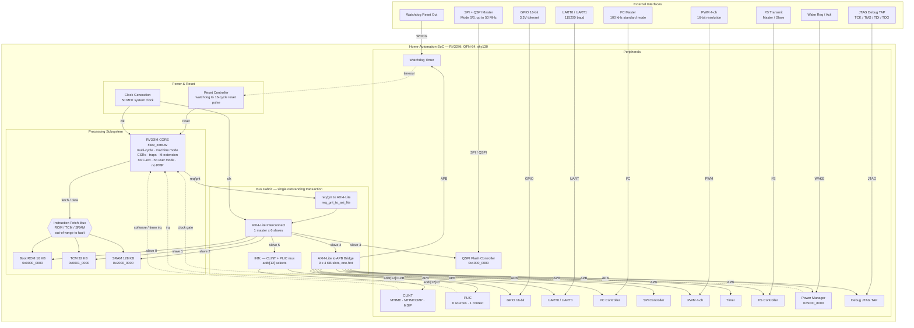

# Home-Automation-SoC

[](research/acceptance-gates.md)
[](rtl)
[](firmware)
[](sim)
[](#-verification-and-formal-testing-capabilities)
[](#-known-limitations-and-unresolved-engineering-blockers)

***

## 📋 Project Overview

> **External review intervention, 2026-11-26.** Baseline `8acc1a4` could not be
> elaborated from a clean checkout: `has_soc.sv` instantiated memory macro wrappers
> that were not in Git. Fixing that surfaced three functional defects (peripheral
> interrupts disconnected after BLK-019, TCM/SRAM preload silently dropped, and a
> read+write deadlock in the memory slave) plus an invalid SDC. All are fixed in
> `3a71175`; the report is [`reports/REVIEW_INTERVENTION_2026-11-26.md`](reports/REVIEW_INTERVENTION_2026-11-26.md)
> and the evidence is in `research/runs/RUN-0025-external-review-2026-11-26/`.
> ASIC readiness, path-based STA and real-macro simulation remain **BLOCKED**;
> see [`docs/EXTERNAL_DEPENDENCIES.md`](docs/EXTERNAL_DEPENDENCIES.md).

**Home-Automation-SoC** is a semiconductor engineering research project delivering a low-power residential home automation System-on-Chip (SoC) in SystemVerilog RTL with bare-metal firmware, verification testbenches, and comprehensive EDA flow scripts. The project investigates RISC-V RV32IM core design, peripheral interconnect, and verification infrastructure on the SkyWater 130nm (sky130A) process node.

**Target Applications:** Smart home hubs, sensor nodes, actuator controllers, IoT gateways  
**External Host:** Home Assistant + Claude-based voice assistant (off-chip)  
**Package Target:** QFN-64  
**Process Target:** SkyWater 130nm (sky130A) — *no PDK provisioned in this environment*  
**FPGA Target:** Digilent Nexys A7-100T (Artix-7 XC7A100TCSG324-1) — *constraints defined, not yet synthesized*  
**Deadline:** 2026-11-28T12:17:36Z (10-day research mandate)

### 🔍 Search Keywords

`RISC-V`, `RV32IMC`, `SoC`, `SystemVerilog`, `AXI4-Lite`, `APB`, `GPIO`, `UART`, `I2C`, `SPI`, `PWM`, `I2S`, `QSPI`, `CLINT`, `PLIC`, `Watchdog`, `Timer`, `Boot ROM`, `SRAM`, `TCM`, `Secure Boot`, `Home Automation`, `Home Assistant`, `SkyWater 130nm`, `sky130`, `Nexys A7`, `Artix-7`, `Yosys`, `Icarus Verilog`, `Verilator`, `cocotb`, `KiCad`, `PCB`, `QFN-64`, `Mermaid`, `block diagram`, `verification`, `regression`, `formal`, `research`

***

## 🏗️ Architecture Overview

<!-- BEGIN MERMAID BLOCK DIAGRAM -->
<!-- Source of truth: docs/architecture/BLOCK_DIAGRAM.md -->
<!-- Regenerate with: python scripts/docs/sync_readme_mermaid.py -->


<!-- END MERMAID BLOCK DIAGRAM -->

### ASCII Block Diagram

```
┌────────────────────────────────────────────────────────────────────────────────────────────────────────────────────────────────┐
│  HOME-AUTOMATION-SOC   ·   QFN-64   ·   SkyWater 130 nm (sky130)   ·   RV32IM                                                  │
│  50 MHz core clock   ·   AXI4-Lite bus fabric   ·   APB peripherals   ·   < 1 mW deep sleep                                    │
└────────────────────────────────────────────────────────────────────────────────────────────────────────────────────────────────┘

EXTERNAL PINS
     │        │       │         │            │            │        │       │         │         │
  UART0    UART1    I2C    SPI/QSPI    GPIO[15:0]    PWM[3:0]    I2S    JTAG    WDOG rst    WAKE
     ▼        ▼       ▼         ▼            ▼            ▼        ▼       ▼         ▼         ▼

┌────────────────────────────────────────────────────────────────────────────────────────────────────────────────────────────────┐
│  HOME-AUTOMATION-SOC                                                                                                           │
│                                                                                                                                │
│                                                                                                                                │
│  ┌──────────────────────────────────────────────────┐  BUS FABRIC                        ┌────────────────────────────────────┐│
│  │ PROCESSING SUBSYSTEM                             │  one outstanding transaction       │ PERIPHERALS                        ││
│  │ instruction fetch + data access                  │                                    │ APB map  0x5000_0000               ││
│  │                                                  │   ┌───────────────────────────┐    │                                    ││
│  │ RV32IM CORE   riscv_core.sv                      │   │ req/gnt → AXI4-Lite       │    │ GPIO[15:0]      0x5000_0000        ││
│  │ multi-cycle · machine mode                       │   │ req_gnt_to_axi_lite       │    │ UART0 / UART1   0x5000_1000        ││
│  │ CSRs · synchronous traps · M extension           │◄► │                           │    │ I2C master      0x5000_2000        ││
│  │ no C-ext · no user mode · no PMP                 │   └───────────────────────────┘    │ SPI master      0x5000_3000        ││
│  │ 4-state FSM: FETCH → EXEC → MEM / TRAP           │                                    │ PWM 4-ch        0x5000_4000        ││
│ │                                                                                     │                                    ││
│  └──────────────────────────────────────────────────┘                                    └────────────────────────────────────┘│
└────────────────────────────────────────────────────────────────────────────────────────────────────────────────────────────────┘
```

> **Source of truth:** `docs/architecture/BLOCK_DIAGRAM.md` — regenerate Mermaid with `python scripts/docs/sync_readme_mermaid.py`.

### Memory Architecture (Reconciled)

| Region | Array | Addressable Aperture | Ports | Status |
|---|---|---|---|---|
| Boot ROM | 4096 × 32 = 16 KiB | 16 KiB — match | 2R 0W | Measured (RUN-0012) |
| TCM | 8192 × 32 = 32 KiB | 32 KiB — match | 2R1W ×4 lanes | Measured (RUN-0012) |
| SRAM | 32768 × 32 = 128 KiB | 128 KiB — match | 2R1W ×4 lanes | Measured (RUN-0012) |
| APB decode LUT | 16 × 9 | 18 B (part of decode logic) | 1R 0W | Measured (RUN-0012) |

**F5 resolution:** the ROM array was 64 KiB behind a 16 KiB aperture and the SRAM
256 KiB behind 128 KiB, so the upper 48 KiB / 128 KiB was unreachable. The
contract is stated identically in `has_addr_map.sv`, the interconnect decode
literals, `linker.ld` and FR-MEM-001/003, so the **arrays were sized to it**
(`ADDR_WIDTH` 14 and 17) rather than enlarging the product to match the arrays.
Growing the map would change a declared requirement and the NFR-AREA-003 area
budget — an owner decision, not a bug fix. No address, boot path or linker
region changed. `audit_memory.js` now reports every array as `match`
(180,224 B addressable, 180,242 B implemented including the LUT); 26 boundary,
alias and byte-write checks in `sim/sim_top/tb_mem_contract.v`.

> **Real memory macro IS integrated in the verified netlist `be827aa...`** (80 × `sky130_sram_2kbyte_1rw1r_32x512_8` + boot_rom, 47,432 stdcells, 142 unique types) — Phase 5.3B. However, the **physical implementation is still blocked** (WSL mount absent, PDN mismatch RUN-0021 PDN-217) and the **full-SoC physical signoff has not been run**. The verified netlist is in `artifacts/synthesis/2026-11-25_synth_20261125_234131/`. The frozen behavioural baseline `b558b41...` is preserved in `artifacts/synthesis/2026-11-25_synth_20261125_200125/`. |
***

## 🧩 Major SoC Components and Features

| Component | Status | Key Details |
|---|---|---|
| **RV32IM Core** | ✅ RTL synthesized, 44,323 generic cells pre-ABC | `riscv_core.sv`: multi-cycle, machine mode, CSRs, traps, M extension. No C-ext, no user mode, no PMP. |
| **Boot ROM** | ✅ 16 KiB, 2R 0W, initialized with NOP fill | `0x0`; behavioural blackbox (`boot_rom.sv`), elaborated from RTL; no silicon init image; default fill is NOP. |
| **TCM** | ✅ 32 KiB, 2R1W ×4 lanes | `0x1_0000`; 4-lane interconnect; **real 2 KiB macro banking (16 instances)** in the verified netlist. |
| **SRAM** | ✅ 128 KiB, 2R1W ×4 lanes | `0x2000_0000`; 4-lane interconnect; **real 2 KiB macro banking (64 instances)** in the verified netlist. |
| **Macro wrapper (SRAM/TCM)** | ✅ Verified (Icarus, 22/22) | `sram_macro_wrap.sv` / `tcm_macro_wrap.sv` implement real-macro banking for the available Sky130 `sky130_sram_2kbyte_1rw1r_32x512_8` (2 KiB, 32×512). Verified via testbench + proxy leaf: 22/22 checks pass (banking, byte strobes, read-after-write, bank selection, bank-boundary alias, instruction-port forward, reset persistence, collision smoke). Macro RTL proven structurally (Yosys parse/check exit 0); formal not yet applied to the real macro model. |
| **AXI4-Lite Interconnect** | ✅ 1 master x 6 slaves | Routes to ROM, TCM, SRAM, QSPI, APB, INTC. |
| **APB Peripheral Bridge** | ✅ 9 x 4 KB slots, one-hot decode | GPIO, UART, I2C, SPI, PWM, Timer, Watchdog, I2S, Power Manager. |
| **Interrupt Controller** | ✅ CLINT + PLIC mux | CLINT: timer/software interrupts. PLIC: 8 sources, 1 context. |
| **Power Manager** | ✅ Clock gating, sleep request | Gates core clock; `sleep_req` exported from register block. |
| **I²C Master** | ✅ 100 kHz standard mode, measured at the pins | F1: STOP is a valid four-quarter sequence. F10: SCL duty corrected to 2 high / 2 low quarters, START hold and bus-free time enforced. 400 kHz fast mode is **not** supported (documented); clock stretching and repeated START are not implemented. |
| **UART** | ✅ 115200 baud; TX/RX with STP/START | I²C STOP protocol defect fixed and regression-covered. |
| **SPI Master** | ✅ Mode 0/3, up to 50 MHz | |
| **PWM 4-ch** | ✅ 16-bit resolution | |
| **I²S Transmit** | ✅ Master / Slave | |
| **Watchdog Timer** | ✅ 16-cycle reset pulse | Fail-closed structure (F8). |
| **Clock Generation** | ✅ 50 MHz system clock | Gated copies distributed to core and AXI. |

***

## 🛠️ Toolchain and EDA Environment

| Category | Tool | Version | Notes |
|---|---|---|---|
| **RISC-V Toolchain** | xPack GCC | 12.2.0-2 | Target `riscv-none-elf`; unified resolver `scripts/fw_build/toolchain.js`; one real toolchain available |
| **Yosys** | Synthesis | 0.69+154 | `techmap`, `dfflibmap`, `abc` front-end; `-liberty` broken (no PDK) |
| **Icarus Verilog** | Simulation | 14.0 | Used for regression; available when the OSS CAD Suite environment is loaded (`call D:\tools\oss-cad-suite\environment.bat`); used this phase to run the macro-wrapper regression (22/22) |
| **Verilator** | C++ simulation / lint | 5.053 | `verilator_bin.exe` works; Perl wrapper broken (`Pod/Usage.pm`). Gate falls back to `verilator_bin`. Lint: 0 errors, 123 `-Wall` warnings over 24 files. Boot: 4 ms simulated in 0.233 s wall (≈17 ms/s — the "~20,000×" claim was wrong by ~6 orders of magnitude). |
| **Formal (SYN)** | SMT solver | via Yosys/SBY | 6/6 properties pass at current state |
| **Verible Lint** | Localparam/style | v0.0-4298 | 54 localparam-style deviations pinned (uart 1, axi_lite_interconnect 1, has_addr_map 34, riscv_core 18) |
| **Symbiyosys** | Property verification | not available | not run at this state |
| **Make** | Build runner | not on PATH | Git Bash POSIX shell used; tools invoked via `cmd //c "call D:\tools\oss-cad-suite\environment.bat && ..."` |
| **Python** | Scripting | Windows Store stub (broken); `D:\tools\venv\Scripts\python.exe` works | `build_fw.py` delegates via `--json`; requires node for delegation |
| **Node.js** | Build delegation | 26.7.0 | `build_fw.py` delegates toolchain discovery through node; resolves to xPack GCC |
| **Linker** | Firmware build | `linker.ld` | Memory regions reconciled per F5 decision |
| **OpenOCD** | FPGA programming | not available | Vivado not available; Nexys A7 constraints defined but not yet implemented |

**Environment notes:**
- Windows/Git Bash: no `make`, no POSIX shell inside cmd; tools invoked through `cmd //c "call D:\tools\oss-cad-suite\environment.bat && …"`
- `python` on PATH is the Windows Store stub; scripts that assume it fail. The venv interpreter (`D:\tools\venv\Scripts\python.exe`) works and is what the gate uses.
- `build/verify/` is a shared mutable log directory — a known provenance weakness; negative-control runs can overwrite real run logs (repaired by re-running at 20:51 on 2026-11-18).
- Only one real RISC-V toolchain exists (xPack 12.2.0-2), so toolchain-conflict behaviour is proven against a missing prefix, not against a second compiler.

***

## ✅ Verification and Formal-Testing Capabilities

| Verification Domain | Result | Evidence |
|---|---|---|
| **Regression (Icarus)** | 28 targets from a clean worktree (27 functional PASS, 1 design stage BLOCKED) | `research/runs/RUN-0025-external-review-2026-11-26/logs/clean_worktree_regression.log` |
| **Macro wrapper (production geometry)** | 81 checks, 0 errors; 64-bank 128 KiB SRAM + 16-bank 32 KiB TCM; **2 negative controls rejected** (3 and 30 failures) | `node scripts/eda/run_macro_wrapper.js`; `research/runs/RUN-0025-external-review-2026-11-26/logs/macro_wrapper_*.log` |
| **Boot ROM (synthesizable)** | 1059 checks against the behavioural model on both modules; CPU boot 7/7 from the generated ROM; Yosys maps 32,840 `$_MUX_` with no `$mem` cell | `node scripts/eda/run_rom_check.js`; `research/runs/RUN-0025-external-review-2026-11-26/logs/rom_*.log` |
| **Timing constraints** | SDC executes as Tcl; 49/49 ports constrained; 0 object errors. **Path-based STA BLOCKED** (no runnable OpenSTA) | `node scripts/eda/run_sdc_lint.js`; `research/runs/RUN-0025-external-review-2026-11-26/logs/sdc_lint.log` |
| **Unified gate** | functional stages PASS; **ASIC readiness BLOCKED** (2 design stages) | `runs/RUN-0012-closure-publication/logs/gate.log` |
| **Firmware build** | exit 0; `.text` 3,684 B; rom 26 words; TCM 895 words | `scripts/fw_build/build_fw.js`; discovery via `toolchain.js` |
| **Firmware E2E** | 7/7 steps, corruption control detected | `scripts/firmware/run_e2e.js` |
| **Formal properties** | 6/6 PASS, exit 0 | `runs/RUN-0011-evidence-provenance/logs/formal.log` |
| **Verilator lint** | 0 errors, 123 `-Wall` warnings, 24 files, exit 1 | `runs/RUN-0011-evidence-provenance/logs/verilator_lint.log` |
| **Verilator C++ build + boot** | exit 0; 7/7 subtests pass; 4 ms simulated in 0.233 s | `runs/RUN-0011-evidence-provenance/logs/verilator_run.log` |
| **Structural checker self-test** | 16/16 controls (checker only — not a design result) | `runs/RUN-0012-closure-publication/logs/structural_self_test.log` |
| **Structural (actual full SoC)** | BLOCKED, exit 2 — 4 declared `$mem_v2` gaps | `runs/RUN-0012-closure-publication/logs/structural_design.log` |
| **Memory audit self-test** | 7/7 drift controls | `runs/RUN-0012-closure-publication/logs/memory_self_test.log` |
| **Memory audit (actual design)** | BLOCKED, exit 2 — arrays reconciled (F5); **real macro integrated in verified netlist `be827aa...` (80 `sky130_sram_2kbyte_1rw1r_32x512_8` + boot_rom), physical signoff still blocked** (WSL mount, PDN mismatch RUN-0021 PDN-217) | `runs/RUN-0012-closure-publication/logs/memory_design.log`; `reports/phase5_3b_report.md`; `artifacts/synthesis/2026-11-25_synth_20261125_234131/` |
| **Memory contract boundaries** | 26/26 checks (apertures, aliases, byte writes) | `sim/sim_top/tb_mem_contract.v` |
| **I²C standard-mode timing** | 23 checks at the pins, 100.00 kHz; 3 negative controls | `scripts/eda/run_i2c_timing.js` |
| **$pmux mapping test** | 7/7 steps, 393,608 vectors, 0 mismatches | `scripts/eda/run_pmux_map_test.js` |
| **dfrbp model test** | 11/11 directed checks, exit 0 | `scripts/eda/run_dfrbp_model_test.js` |

**Flow:** `node scripts/closure.js` is the single entry point: environment and
resolved tool versions → publication completeness (Git index) →
`scripts/verify.js`. The gate runs: tools → Verible syntax → Verible lint →
regression → formal → CDC inventory → protocol tests → memory contract → I²C
timing → **structural self-test** and **structural design** (separate stages) →
**memory self-test** and **memory design** → Mermaid → docs sync.

Exit codes: `0` every stage passed, `1` a stage failed, `2` a stage is BLOCKED.
The current run exits **2**: the functional suite passes, but the two
actual-design stages are BLOCKED on the four inferred memories. A green
checker self-test is reported separately and never substitutes for that.

> **Important:** `build/verify/` is a shared mutable log directory. A negative-control run overwrote a real run's logs at 20:51 on 2026-11-18 and was repaired by re-running the gate. Run-scoped log directories are not implemented.

***

## 📊 Research Findings F1–F9 and Current Statuses

| ID | Finding | Status | Gist | Next Step |
|---|---|---|---|---|
| **F1** | I²C STOP releases SCL and SDA in the same cycle | **FIXED** | Real defect. Negative control failed (5 failures, exit 1) before fix; passed after (`stops=1`); integration 27/27 + 9/9 (RUN-0002/0003/0004). | Residual: do_stop still ignored (command without stop bit also terminates with STOP); analog setup time not modelled. |
| **F2** | `$pmux` mapper single-select branch connects vectors to a scalar mux2_1 when WIDTH>1 | **FIXED** | Vectors were truncated to bit 0; 130,048 / 393,608 vectors wrong before; 0 after; 9 `$equiv` cells proven; `arith_test` netlist byte-identical pre/post (RUN-0005/0006). | Residual: equivalence uses behavioural mux2_1 model; other map rules not covered by this test. |
| **F3** | Local dfrbp behavioral models trigger on the wrong clock edge | **FIXED** | Stub used `negedge CLK`; fixed to `posedge CLK` (only change); 11/11 directed checks pass; pre-fix control fails 3/11 (exit 1). Sky130 full liberty `ff` block present at line 1587; the earlier "omitted" note was wrong. | Residual: mapper never emits dfrbp (uses dfxtp_1/dfrtp_1/dfstp_1); functional only, no timing. |
| **F4** | Arithmetic mapping demonstration references an unpublished source file | **FIXED** | Source and testbench lived only in gitignored `build/` (F4). Byte-identical copies now at `asic/synthesis/provenance/{arith_test.v,tb_equiv.v}` with `map_arith.ys`; 1,028 equivalence checks PASS (exit 0); corrupt-netlist control exits 1. | No action; provenance copies must be committed together with the evidence. |
| **F5** | Allocated ROM/SRAM sizes may disagree with the address map and documentation | **FIXED** (RUN-0012) | Confirmed: ROM array 64 KiB behind a 16 KiB aperture, SRAM 256 KiB behind 128 KiB — 48 KiB and 128 KiB unreachable, an area/macro-sizing defect. Resolved by sizing the arrays to the declared contract (`ADDR_WIDTH` 14/17), not by enlarging the map. `audit_memory.js` now reports every memory as `match`; 26 boundary/alias/byte tests. | — |
| **F6** | Some build entry points bypass shared toolchain discovery | **FIXED** | One validated resolver (`scripts/fw_build/toolchain.js`); precedence: option → `RISCV_GCC_PREFIX` → `RISCV_TOOLCHAIN_BIN` → PATH → installed xPack tree; each candidate validated on `-dumpmachine`/`-march`/`objcopy`; bad override exits 2; 10/10 discovery controls, 6/6 negative controls exit 2; `run_e2e.js` hardcoded path removed. | No action; any new driver must call `findToolchain()` or delegate to one that does. |
| **F7** | Full-SoC synthesis may retain inferred memories without a complete implementation inventory | **BLOCKED** (inventory complete, no implementation) | 4 inferred `$mem_v2` measured (RUN-0012): boot ROM 16 KiB 2R, TCM 32 KiB 2R1W, SRAM 128 KiB 2R1W, 18 B decode LUT; plus register file (1024 bits) and PLIC priority (64 bits); no FIFOs. No `.lib`/`.lef`/`.gds` or memory compiler exists and no PDK is provisioned. `memory-design` reports BLOCKED by name for each. | Obtain a macro or blackbox whose ports, initialisation and timing meet the documented requirements, or record an owner decision to accept an alternative; the gap is versioned in `asic/synthesis/structural_policy.json` so it cannot silently become a PASS. |
| **F8** | Full-SoC structural checks may report problems without failing the run | **FIXED** | A structural check that finds problems must fail the run (fail-closed gate). Now `check -assert` + library-cell allowlist + exact declared-gap accounting + non-empty mapping rule (exit 0/1/2). RUN-0007: 7/7 controls, gate 10/10; full SoC BLOCKED on 4 `$mem_v2`. | Residual: 192 s full-SoC mapping not in every gate run; counts are per module definition (no flatten). |
| **F9** | Existing test totals and reports may lack fresh commit-matched raw evidence | **PARTIAL** (regression + gate re-run; Verilator/formal not re-run at pre-025ef24 numbers) | RUN-0011 re-ran every named target at 025ef24 + dirty tree: regression 27/27, gate 10/10, firmware build 3,684 B + E2E 7/7, formal 6/6, Verilator lint 0 errors/123 warnings/24 files, Verilator C++ rebuild + boot 7/7 (4 ms in 0.233 s), structural BLOCKED on 4 `$mem_v2`, memory audit BLOCKED (F5), pmux 7/7/393,608 vectors, dfrbp 11/11 + control exit 1, arith equivalence 1,028 checks. README corrected (10/10 gate, 24 files, 44,323-cell core synth, four `$mem_v2`, no 20,000× claim). Historical reports banner-marked, not rewritten. | Keep reports banner-marked; scope gate logs per run id; never cite pre-025ef24 numbers as current. |
| **F10** | I²C standard-mode timing (tHIGH/tLOW/START/STOP/bus-free) not checked, and SCL was high for only 1 of 4 quarters | **FIXED** (RUN-0012) | At pclk 50 MHz / CLKDIV 124 the generator gave tHIGH 2.5 µs against a 4.0 µs minimum and tHD;STA 2.5 µs against 4.0 µs. SCL now holds for quarters 1–2, START holds SDA two quarters, DONE spans four. Measured at the pins with a 300 ns delayed-rise model: fSCL 100.00 kHz, tHIGH 4700 ns, tLOW 5300 ns, tSU;DAT 2500 ns, tHD;DAT 20 ns, tHD;STA 5000 ns, tSU;STO 5000 ns, tBUF 14720 ns; 23 checks, 5/5 runner controls | Fast mode (400 kHz), clock stretching and repeated START are **not** supported and are not claimed |
| **F11** | Two supported commands only worked in the author's checkout: they wrote into `build/` directories nothing created | **FIXED** (RUN-0014) | A separate worktree with only tracked files failed: `as.js` → `ENOENT build/fw/boot.hex` (boot regression IMAGE-FAIL, 26/27) and `memory_audit.ys` → `Can't create file` (memory stages produced no verdict; this Yosys build has no `file mkdir`). Reproduced deterministically at `d09d59e`. Producers now create their own outputs; `audit_memory.js --elaborate` is the documented entry point. Re-run at `eff293d`: publication COMPLETE, 13/13 functional, 27/27 regression, 2 design stages BLOCKED | Any new stage that writes `build/` must create its own directory |

**Summary:** F1, F2, F3, F4, F5, F6, F8, F10, F11 **FIXED**. F7 **BLOCKED** (complete inventory, no memory implementation). F9 **PARTIAL** (all current targets traced at the tested commit; no PPA, no independent review; historical reports banner-marked). **Highest gate: G0 PASS** (G1/G2 PARTIAL, G3/G4 OPEN). ASIC readiness is BLOCKED and this repository makes no tapeout-readiness claim.

***

## 📈 Current Gate Status

Gate status vocabulary: `PASS` (checked in this study with linked evidence), `PARTIAL`, `OPEN` (not attempted or blocked), `FAIL`. A gate is `PASS` only when **every** applicable criterion below it is `PASS`. Everything is **SELF-EVALUATED** — no independent evaluator exists.

```
G0:     PASS (G0.1–G0.5 all pass)  ────── highest verified gate
G1:     PARTIAL (G1.1, G1.3, G1.4, G1.5 partial)
G2:     PARTIAL (G2.1–G2.2 partial; G2.4–G2.6 OPEN)
G3:     OPEN (all OPEN; no PDK, no macro, no P&R)
G4:     OPEN (all OPEN; G4.4 no independent evaluator)
```

### G0 — Reproducible baseline (PASS)

| # | Criterion | Status | Evidence |
|---|---|---|---|
| G0.1 | Exact source state identified, worktree dirty-state recorded | PASS | `runs/RUN-0001-baseline-025ef24/source-manifest.json`; HEAD `025ef24` |
| G0.2 | Tools inventoried with versions and availability | PASS | `runs/RUN-0001-baseline-025ef24/logs/tools.txt` |
| G0.3 | Requirements and implementation boundary frozen | PASS | `research/requirements-baseline.md` |
| G0.4 | Existing verification results reproduced at this commit, or marked unverified | PASS | RUN-0011 re-ran every named target at `025ef24` + dirty tree: regression 27/27, gate (10 stages then), firmware 3,684 B, E2E 7/7, formal 6/6, Verilator lint 0 errors, Verilator C++ boot 7/7, structural BLOCKED on 4 `$mem_v2`, memory audit BLOCKED as declared. RUN-0012 re-ran the 13-stage gate and the publication check from a clean tree. PPA and wrapper-based claims marked unverified. |
| G0.5 | No missing build inputs or unexplained stale-artifact dependency | PASS | F4 fixed: arithmetic source and testbench published at `asic/synthesis/provenance/` with hashes equal to the originals; stale artifacts identified and either regenerated or banner-marked historical. No unexplained dependency remains. |

**G0 overall: PASS** (G0.1–G0.5 all pass). Independent reproduction is a G4 requirement, not G0.

### G1 — Qualified RTL and firmware (PARTIAL)

| # | Criterion | Status | Evidence |
|---|---|---|---|
| G1.1 | Required behaviour traced to executable checks | PARTIAL | per-peripheral testbenches + `scripts/verify.js`; traceability table not complete |
| G1.2 | CPU, memory, bus, interrupt, reset, peripheral tests pass | PASS | regression 27/27, `runs/RUN-0001-baseline-025ef24/logs/regression.log` |
| G1.3 | Formal properties have reviewed assumptions and reachability | PARTIAL | 6/6 properties run; assumptions not externally reviewed |
| G1.4 | Sensor input → firmware decision → GPIO output → UART report through the real SoC | PARTIAL | C demo exercises UART, GPIO, watchdog reset; no sensor model exists |
| G1.5 | Watchdog reset/recovery during defined active-transaction cases | PARTIAL | idle-path reset demonstrated; reset during an active APB/AXI transaction not yet tested |
| G1.6 | Fresh firmware built from source with recorded provenance | PASS | `build_fw.js`/`gen_fw_mem.js` with discovery; image SHA-256 recorded in run artifacts |
| G1.7 | I²C bus protocol valid on the wire (START/STOP/data/ACK) | PASS | STOP phasing fixed (RUN-0002 fails, RUN-0003 passes) |
| G1.8 | I²C numerical timing meets the declared mode on the wire | PASS (standard mode only) | RUN-0012, `sim/sim_top/tb_i2c_timing.v`, measured at the ports with a 300 ns delayed-rise bus model: fSCL 100.00 kHz, tHIGH 4700 ns, tLOW 5300 ns, tSU;DAT 2500 ns, tHD;DAT 20 ns, tHD;STA 5000 ns, tSU;STO 5000 ns, tBUF 14720 ns; 23 checks. `scripts/eda/run_i2c_timing.js` 5/5 including a too-fast divider, a simultaneous-release mutant and a one-quarter START hold. 400 kHz, clock stretching and repeated START are out of scope and documented as such |

**G1 overall: PARTIAL** — the protocol defect found on day 1 is fixed and regression-covered; G1.1, G1.3, G1.4 and G1.5 remain partial (no sensor path, no externally reviewed formal assumptions, watchdog reset during an active transaction not tested).

### G2 — ASIC implementation baseline (PARTIAL)

| # | Criterion | Status | Evidence |
|---|---|---|---|
| G2.1 | Real library cells and actual memory implementations identified | PARTIAL | cells mapped from `sky130_fd_sc_hd`; all four inferred memories are identified, sized and now agree with the address map, interconnect and linker (RUN-0012, F5 fixed), but no memory implementation exists (F7 BLOCKED) |
| G2.2 | No unexpected unresolved cells, multiple drivers, undriven signals | PARTIAL | Enforced and negative-controlled: `check -assert` + library-cell allowlist + gap accounting. The checker now has 16 controls including missing, empty, truncated, stale and wrong-module reports and a broken tool invocation (RUN-0012). The clean baseline PASSes; `has_soc` is **BLOCKED** on 4 declared `$mem_v2`, so the criterion cannot pass yet |
| G2.3 | Mapping/equivalence checks cover the transformations actually used | PARTIAL | `$pmux` rule now covered by exhaustive simulation + cell-level equivalence, negative-controlled (RUN-0005/RUN-0006). All 11 sequential cell models the stub defines now match their liberty `clocked_on`, and `dfrbp` is proven by directed vectors with a pre-fix negative control (RUN-0008, F3 closed). Still only one mapping rule ($pmux) is equivalence-checked; other `sky130_map.v` rules are unproven |
| G2.4 | Clock, I/O, reset and timing exceptions explicit and justified | OPEN | no SDC audited; no pad ring |
| G2.5 | Memory, pad, clock, power interfaces consistent | OPEN | no pads; memory strategy unresolved (the requirement set is in RUN-0009: 2R1W byte-enable SRAM, dual-read ROM, F5 capacity decision outstanding) |
| G2.6 | Test access and manufacturing-test strategy documented | OPEN | DFT not started |

**G2 overall: PARTIAL.**

### G3 — Physical closure (OPEN)

| # | Criterion | Status | Evidence |
|---|---|---|---|
| G3.1 | Selected design placed and routed | OPEN | no PDK and no memory macro; a macro-backed netlist cannot be built, let alone placed |
| G3.2 | Connectivity/placement checks pass | OPEN | no implementation exists |
| G3.3 | Extracted setup/hold meets frozen constraints at required corners | OPEN | — |
| G3.4 | DRC, LVS, antenna, electrical, power integrity pass | OPEN | — |
| G3.5 | Waivers externally authorized, not self-approved | OPEN | no waivers |

**G3 overall: OPEN.**

### G4 — Audited handoff package (OPEN)

| # | Criterion | Status | Evidence |
|---|---|---|---|
| G4.1 | Source, netlist, layout, constraints, reports, manifests correspond | OPEN | no layout |
| G4.2 | Abstracts, timing models, power, test collateral present | OPEN | — |
| G4.3 | IP/PDK provenance recorded | PARTIAL | PDK provenance documented; no package |
| G4.4 | Independent reviewer evaluates the frozen package | OPEN | **no independent evaluator available** |
| G4.5 | All required gates pass without blocking findings | OPEN | — |

**G4 overall: OPEN.**

***

## 🧠 Research Methodology, Reproducibility, and Evidence Approach

### Measurement methodology

- **Result reported** only when a run has: source revision, dirty-state recording, command, tool versions, exit code, and artifact hash.
- **Runs are immutable:** a rerun gets a new `RUN-ID`; the original is preserved verbatim. RUN-0001 through RUN-0011 exist as audit trails.
- **Evidence matrix:** `research/runs/RUN-0011-evidence-provenance/evidence-matrix.md` lists every current claim with its provenance.
- **Historical reports** (`reports/verification/*`) are banner-marked as superseded; numbers are untouched and preserved as history.

### Provenance and attribution

- Every `PASS` claim in this README is traceable to a `RUN-ID` and artifact hash.
- **No claim of independent validation** is made — every result is SELF-EVALUATED. G4 (audited handoff) is unreachable without an independent evaluator.
- The `research/findings.csv` and `research/results.csv` records track findings and metrics across sessions; rows are never rewritten, only appended or superseded with a new status.

### Evidence tree (selected)

| RUN-ID | Purpose | Key Results |
|---|---|---|
| RUN-0001 | Baseline reproduction | regression 27/27, gate 9/9, both exit 0 |
| RUN-0002 | I²C STOP negative control | 5 failures / exit 1 before fix |
| RUN-0003 | I²C STOP fix verification | stops=1; pass; integration 27/27 + 9/9 |
| RUN-0004 | I²C STOP integration | regression 27/27 + gate 9/9, exit 0 |
| RUN-0005 | `$pmux` prefix mapper control | 130,048 mismatches, exit 1 |
| RUN-0006 | `$pmux` postfix mapper fix | 0 mismatches; 9 equiv cells proven |
| RUN-0007 | Structural fail-closed gate | 7/7 controls; full SoC BLOCKED on 4 `$mem_v2`; gate 10/10 |
| RUN-0008 | `dfrbp` clock edge model | 11/11 checks; pre-fix control fails 3/11 |
| RUN-0009 | Memory architecture audit | 4 inferred memories; F5 confirmed; F7 BLOCKED no macro |
| RUN-0010 | Toolchain unification | one resolver; 10/10 + 6 negative controls; gate 10/10 |
| RUN-0011 | Evidence provenance audit | 27/27 regression, 10/10 gate, 7/7 formal, 7/7 Verilator boot, 0 lint errors, structural BLOCKED, memory audit BLOCKED, pmux 7/7, dfrbp 11/11, arith 1,028 checks |
| RUN-0012 | Publication repair, memory contract, I²C timing, gate split | closure entry point on a clean tree; publication complete; 26/26 memory checks; 23 I²C timing checks + 3 controls; 16/16 structural controls; design stages BLOCKED |
| RUN-0013 | Confirmation at the pushed revision | publication COMPLETE; 13/13 functional; 2 design BLOCKED (identical to RUN-0012) |
| RUN-0014 | Clean-checkout reproduction | separate worktree: found and fixed F11, then publication COMPLETE, 13/13 functional, regression 27/27, 2 design BLOCKED |
| RUN-0015 | Real-macro integration + macro-wrapper verification + ROM decision (Phase 5.3B) | 80 real `sky130_sram_2kbyte_1rw1r_32x512_8` macros + boot_rom in verified netlist `be827aa...`; 22/22 Icarus wrapper checks (proxy-leaf TB); Yosys structural parse/check exit 0; ROM = behavioural blackbox (no real ROM macro); both baselines preserved (frozen `b558b41...` + verified `be827aa...`); physical signoff still blocked (WSL mount, PDN mismatch RUN-0021 PDN-217) |

> The `gate N/N` figures above are each run's own record and are preserved as
> history. The gate grew from 9 to 10 to 13 stages (RUN-0012 split the checker
> self-tests from the design checks and added `publication`, `memory-contract`,
> `i2c-timing`, so a 10/10 is not comparable to a 13/13). Cite the run, not the
> fraction.

All run logs, commands, and artifact hashes are in `research/runs/`
(`RUN-0011-evidence-provenance/`, `RUN-0012-closure-publication/`).

***

## ⚠️ Known Limitations and Unresolved Engineering Blockers

### Environment limitations (no ASIC readiness)

- **Physical implementation blocked (not synthesis):** the verified netlist `be827aa...` exists (real macros integrated), but OpenROAD/OpenSTA flow cannot run here — the WSL mount of the project at `/mnt/d/Home-Automation-SoC` is absent/broken, and the Windows OpenROAD binary is a Linux ELF. This is the **WSL mount blocker**, carried from Phase 5.1; no place/route/extraction/DRC/LVS/STA for the full SoC has executed.
- **PDN pin mismatch (RUN-0021 PDN-217):** the macros' LIB `pg_pin` names are `vccd1`/`vssd1`, which do not match the stock ORFS PDN patterns that expect `VPWR`/`VGND`. An explicit `add_global_connection(vccd1→VPWR, vssd1→VGND)` is required in the physical flow.
- **No Vivado / FPGA hardware:** Stage 5 cannot be synthesized or programmed. FPGA claims are constrained but unverified.
- **No independent evaluator:** G4 (audited handoff) is unreachable by construction; every result is SELF-EVALUATED.
- **No held-out test set, no external reference model, no third-party signoff.**

### Design limitations

- **Memory init/reset gap (macro wrapper):** the real Sky130 `sky130_sram_2kbyte_1rw1r_32x512_8` macro has **no reset pin and no init path** (mem uninitialized at time 0). The wrapper resets only its own FSM/regs, not the macro's memory. TCM/SRAM must be initialized by boot code (or a real ROM macro, if one becomes available). The boot ROM (`boot_rom.sv`, 16 KiB behavioural blackbox) is the only initialized memory in the system.
- **ROM macro unavailable:** no compatible read-only, initialized real macro exists on this machine (all real macros are writable SRAM). `boot_rom.sv` behavioural blackbox is retained as the only ROM implementation. This is a **system-level ROM-implementation gap**, not a wrapper defect; recorded in `reports/phase5_3b_report.md` §3.
- **Formal not yet applied to the real macro model:** the macro behavioural model has `#delay`, `$display`, uninitialized `mem` — SBY/SMT solvers may not handle it cleanly; the existing formal `.sby` tasks target the old behavioural `sram.sv`, not the new macro wrapper. Formal equivalence between the wrapper and the real macro model is **not claimed**.
- **Icarus simulation uses proxy leaf cells:** the real macro `.v` is Icarus-incompatible (`mem[addr_reg]` indexed access with a reg index → "Scope index expression is not constant"). The macro-wrapper verification (22/22) uses simulatable behavioural proxies (`tb_macro_leaf.v` / `tb_macro_leaf_1kb.v`) that mirror the macro protocol, not the real macro's internals. Timing-accurate macro behaviour is not verified by this method.
- **Full-SoC flatten fails:** `std::bad_alloc` on behavioural SRAM; counts are per module definition, not a flat total.
- **Verilator Perl wrapper broken:** `Pod/Usage.pm` missing; only `verilator_bin.exe` 5.053 works. The unified gate falls back to `verilator_bin` instead of reporting Verilator absent.
- **Verilator lint: 123 warnings.** Calling 0 warnings "PASS" overstates it. Lint exits 1 under `-Wall`.
- **`build/verify/` is a shared mutable log directory:** A negative-control run can overwrite a real gate run's logs (repaired by re-running at 20:51 on 2026-11-18). Run-scoped log directories are not implemented.
- **Toolchain: only one real compiler:** xPack GCC 12.2.0-2. No second toolchain available for conflict testing.
- **Python on PATH is the Windows Store stub:** Scripts that assume it fail. The venv interpreter (`D:\tools\venv\Scripts\python.exe`) works and is what the gate uses.

### Verified but unfinished

- **PPA does not exist:** No ABC `-liberty`, no PDK, no place/route. Cell counts are generic pre-ABC (riscv_core: 44,323 cells), not area or timing.
- **No silicon exists:** Any statement implying measurement, foundry approval or manufacturing signoff would be false.
- **Physical signoff not done:** the verified netlist has real macros, but DRC/LVS/antenna/STA signoff for the full SoC has not been run (physical blockers above).
- **F5 resolution not independently approved:** The memory arrays were sized to the existing requirement (16 KiB ROM, 128 KiB SRAM) rather than the requirement being changed. The rationale is recorded; no independent reviewer exists to confirm the reading of the requirement.

### Report limitations

- `reports/verification/{README,TEST_RESULTS,VERIFICATION_BASELINE_2826b5b}.md` are **banner-marked as historical**; original numbers are untouched and preserved. Do not quote those numbers as "current."
- `resume.md` is **stale** — says regression 17/17 and Verilator "blocked"; both superseded (regression is 27/27; `verilator_bin.exe` works).
- `AGENTS.md` sections 1–7 and `reports/MASTER_PROJECT_STATUS.md` are **snapshots from earlier sessions**, not current.

***

## 🛣️ Roadmap and Next Research Phases

| Phase | Objective | Blockers | Estimated effort |
|---|---|---|---|
| **Phase 4** | F5/F7 memory capacity decision and macro integration | F5 documented but unapproved; no memory macro (now real-macro integrated for synthesis) | 1–2 weeks (if PDK becomes available) |
| **Phase 5** | Formal property review with external reviewer | No independent evaluator in this environment | Requires external model or third-party signoff |
| **Phase 5.3B (complete)** | Real-macro SRAM/TCM banking + macro-wrapper verification + ROM decision | **Done**: 80 real macros in verified netlist `be827aa...`; 22/22 wrapper checks; Yosys structural parse OK; ROM = behavioural blackbox (no real ROM macro); both baselines preserved | Phase 5.3B complete — see `reports/phase5_3b_report.md` |
| **Phase 6** | Physical implementation (OpenROAD/OpenSTA flow) | **WSL mount blocker** (`/mnt/d/Home-Automation-SoC` absent); **PDN mismatch RUN-0021 PDN-217** (vccd1/vssd1 vs VPWR/VGND); no macro init path; no real ROM macro | Requires WSL mount fix + PDN global-connection fix + (optionally) ROM macro procurement |
| **Phase 7** | Gate G1–G4 advancement | G1.1, G1.3, G1.4, G1.5 partial; G2.4–G2.6 OPEN; G3 all OPEN; G4.4 no independent evaluator | Requires physical signoff + formal assumption review + DFT initiation |
| **Phase 8** | FPGA synthesis and implementation | Vivado not available; Nexys A7 constraints defined but not synthesized | Requires Vivado license and hardware |

**Long-term goal (beyond this 10-day mandate):** With a provisioned sky130A PDK, complete OpenLane 2 flow (synthesis → place & route → DRC/LVS/STA → tapeout documentation). Without a PDK, this project remains a verified RTL + firmware + research-grade verification infrastructure study, not an ASIC-ready design.

***

## 📁 Repository Structure (top-level)

```
├── .gitignore               git-negated research run logs
├── README.md                this file (professional showcase)
├── AGENTS.md                agent handoff + change-log
├── constraints/             pin assignment & timing constraints
├── docs/                    architecture, requirements, docs
│   └── architecture/        block diagram, Mermaid, decision records
│       └── MACRO_MAPPING_INVENTORY.md   real Sky130 macro availability + wrapper mapping (Phase 5.3B)
├── fpga/                    Nexys A7 constraints, bringup guide
├── ip/                      internal / third-party IP (none downloaded)
├── rtl/                     SystemVerilog RTL sources
│   └── rtl_top/             top-level and peripheral modules
│       ├── sram_macro_wrap.sv            SRAM macro-bank wrapper (64 macros, 128 KiB)
│       ├── tcm_macro_wrap.sv             TCM macro-bank wrapper (16 macros, 32 KiB)
│       ├── boot_rom.sv                    behavioural ROM blackbox (16 KiB)
│       └── has_soc.sv                    SoC top (rom + tcm + sram instances)
├── sim/                     simulation top-level and wavefiles
│   └── sim_top/            macro-wrapper directed TB + proxy leaf cells
│       ├── tb_sram_macro_wrap.v         SRAM/TCM wrapper testbench (22 checks)
│       ├── tb_macro_leaf.v              simulatable proxy for sky130_sram_2kbyte_1rw1r_32x512_8
│       └── tb_macro_leaf_1kb.v          simulatable proxy for sky130_sram_1kbyte_1rw1r_32x256_8
├── constraints/             pin & timing constraints
├── asic/                    ASIC physical-design flow scripts
│   ├── synthesis/           Yosys techmap, map scripts
│   └── synthesis/provenance/  F4 byte-identical copies (arith_test.v, tb_equiv.v, map_arith.ys)
├── artifacts/synthesis/     **preserved synthesis baselines** (NOT committed to git)
│   ├── 2026-11-25_synth_20261125_200125/   frozen baseline b558b41... (behavioural sram ×2 + boot_rom)
│   └── 2026-11-25_synth_20261125_234131/   verified real-macro netlist be827aa... (80 macros + boot_rom)
├── firmware/                Bare-metal + RTOS + driver sources
├── scripts/                 EDA and firmware build scripts
│   ├── fw_build/            toolchain discovery + build flows
│   ├── eda/                 yosys, Verilator, formal, structural checks
│   │   └── probe3_full.bat  macro-wrapper compile+run (iverilog -g2012 -DUSE_POWER_PINS)
│   └── docs/                code-generation scripts
├── artifacts/synthesis/     **preserved synthesis baselines** (NOT committed to git)
│   ├── 2026-11-25_synth_20261125_200125/   frozen baseline b558b41... (behavioural sram ×2 + boot_rom)
│   └── 2026-11-25_synth_20261125_234131/   verified real-macro netlist be827aa... (80 macros + boot_rom)
├── reports/                 verification results, formal specs, delivery reports
│   ├── phase5_3b_report.md             Phase 5.3B: macro integration, ROM decision, verification evidence
│   ├── soc_synthesis_status_final.md  Phase 5.3A frozen-baseline synthesis report
│   ├── synthesis_execution_summary.json   authoritative run result (be827aa...)
│   └── verification/        historical reports (banner-marked)
├── tb/                      legacy testbenches (superseded by sim/sim_top/)
├── TECH_STACK.md            complete tech stack inventory
└── research/                study evidence, findings, gates, limits
    ├── runs/                RUN-0001…RUN-0011 evidence trees
    ├── findings.csv         F1–F9 triage
    ├── results.csv          experiment metrics
    ├── experiment-matrix.csv        run plan
    ├── acceptance-gates.md  G0–G4 gate definitions
    └── limitations.md       environment & design limitations
```

### How to reproduce major verification runs

The single entry point is `scripts/closure.js`. It first proves that every input
it needs is in the Git tree, then runs the full gate, and writes one log per
stage under `build/closure/`. Run it at the repository root of a clean checkout.

```bash
# Prerequisite: put yosys/iverilog/sby on PATH (OSS CAD Suite here)
export PATH="/d/tools/oss-cad-suite/bin:/d/tools/oss-cad-suite/lib:$PATH"

# Publication completeness + full verification gate
node scripts/closure.js
#   exit 0 = every stage passed
#   exit 1 = a stage failed
#   exit 2 = a stage is BLOCKED (the current state: ASIC readiness)

# Individual stages, to look at one thing at a time
node scripts/publication/check_publication.js     # Git index only, exit 0/1
node scripts/verify.js                            # the gate (exit 2 at present)
node scripts/verify.js --only=structural-design,memory-design
node scripts/eda/check_structure.js --self-test   # 16/16 checker controls
node scripts/eda/audit_memory.js --self-test      # 7/7 drift controls
node scripts/eda/audit_memory.js --elaborate      # elaborate + audit; expect BLOCKED, exit 2 (F7)
node scripts/eda/run_i2c_timing.js                # 5/5, incl. 3 failing controls
node scripts/eda/run_pmux_map_test.js             # 7/7, 393,608 vectors
node scripts/eda/run_dfrbp_model_test.js          # 11/11 + failing pre-fix control
```

Tool locations are environment overrides, never hidden defaults: `EDA_TOOLS`,
`VERIBLE_DIR`, `PYTHON`, `RISCV_GCC_PREFIX`, `RISCV_TOOLCHAIN_BIN`. The run
records the resolved path and version of every tool it used.

> **Never cite pre-`025ef24` numbers as current.** Historical reports (`reports/verification/*`) are banner-marked; their numbers are superseded.

***

## 🔗 Links to Relevant Reports and Evidence

| Category | File | Description |
|---|---|---|
| **Evidence matrix** | `research/runs/RUN-0011-evidence-provenance/evidence-matrix.md` | Every current PASS claim with source SHA, command, tool version, exit code, and artifact hash |
| **Findings triage** | `research/findings.csv` | F1–F9 status, evidence gist, next action |
| **Experiment plan** | `research/experiment-matrix.csv` | E0–E8 run plan, conditions, sources, status |
| **Metric log** | `research/results.csv` | E0–E8 experiment_id, run_id, metric, value, exit_code, commit, wall_s, evidence |
| **Gate definitions** | `research/acceptance-gates.md` | G0–G4 definitions, PASS/PARTIAL/OPEN classification |
| **Limitations** | `research/limitations.md` | Evaluation, provenance, environment, evidence, study design |
| **Memory decision** | `research/MEMORY_ARCHITECTURE_DECISION_INVESTIGATION.md` | F5 reconciled to the declared contract, F7 BLOCKED with the missing-resource list |
| **Closure run** | `research/runs/RUN-0012-closure-publication/` | Publication completeness, gate split, memory contract, I²C timing |
| **F4 provenance** | `asic/synthesis/provenance/{arith_test.v,tb_equiv.v,map_arith.ys}` | Byte-identical copies with reproducible map script |
| **Historical verification** | `reports/verification/{README,TEST_RESULTS,VERIFICATION_BASELINE_2826b5b}.md` | Banner-marked as superseded; numbers untouched |
| **Master project status** | `reports/MASTER_PROJECT_STATUS.md` | Snapshots from earlier sessions (not current) |
| **Agent handoff** | `AGENTS.md` | Change-log rows + coordination pointer |
| **Daily logs** | `research/coordination/DAILY/2026-11-18.md` | Session S-2026-11-18-1 through S-2026-11-18-7 |
| **Work/log reviews** | `research/coordination/{WORK_LOG.md,REVIEW_LOG.md}` | Append-only history, one block per event |
| **Block diagram** | `docs/architecture/BLOCK_DIAGRAM.md` | Source of truth for Mermaid regeneration |

***

## 📜 Licensing

**Proprietary** — LICENSE file intentionally blank without owner approval. No open-source license is granted or implied. This project is a research-grade semiconductor engineering study.

*(Status badge: research prototype — not production-ready; not tape-out ready; not foundry-approved.)*