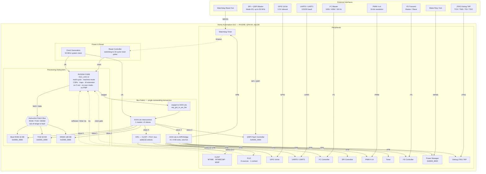

# Home-Automation-SoC — System Block Diagram

The diagram below is the single source of truth for the block diagram in
`README.md`. It is generated into the README by
`scripts/docs/sync_readme_mermaid.py` and validated by
`scripts/docs/check_mermaid.mjs`.

Every fact is taken from the RTL:

| Fact | Source |
|------|--------|
| Core is RV32IM, machine mode, no C-ext / user mode / PMP | `rtl/rtl_top/riscv_core.sv` header |
| Boot ROM 16 KB, TCM 32 KB, SRAM 128 KB | `rtl/rtl_top/has_addr_map.sv` |
| Bus fabric: 1 master × 6 slaves, single outstanding | `rtl/rtl_top/axi_lite_interconnect.sv` |
| 9 APB slots, one-hot | `rtl/rtl_top/axi_lite_to_apb.sv` |
| CLINT at `addr[12]=0`, PLIC at `addr[12]=1` | `rtl/rtl_top/intc_axi.sv` |
| Peripherals and their APB addresses | `rtl/rtl_top/has_soc.sv` |

> **Mermaid gotcha:** an edge label containing `[` or `]` must be quoted, e.g.
> `INTC -->|"addr[12]=0"| CLINT`. Unquoted brackets terminate the label
> early and GitHub fails with *"Unable to render rich display"*.
> `scripts/docs/check_mermaid.mjs` renders the diagram with the same parser
> GitHub uses and fails on the same mistake.

