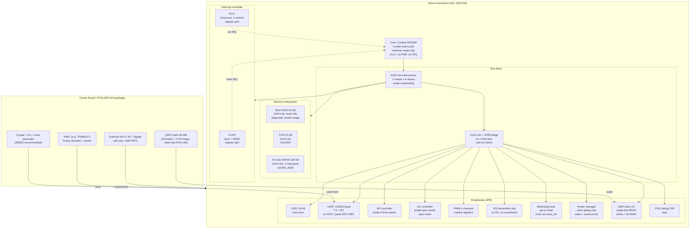

# System Block Diagram

## Overview
This document specifies the top-level system block diagram and subsystem interfaces for the Home-Automation-SoC (HAS-SoC).## Block Diagram (Mermaid)

## Block Diagram (ASCII, for quick reference)

`
+-------------------------------------------------------------+
|                      Carrier Board / PCB                    |
|  +-----------------------+     +-------------------------+  |
|  | QSPI Flash 64 MB      |     | External Wi-Fi/BT/Zigbee|  |
|  | (Firmware + OTA)      |     | (off-chip, UART/SPI)    |  |
|  +-----------+-----------+     +------------+------------+  |
|              | QSPI                         | UART/SPI     |
|  +-----------v------------------------------v------------+  |
|  |              Home-Automation-SoC (QFN-64)             |  |
|  |                                                       |  |
|  |  +-----------------------------------------------+   |  |
|  |  | Core: Custom RV32IM (4-state, machine mode)    |   |  |
|  |  | NOT Ibex; no C/PMP/F/D/user mode               |   |  |
|  |  +---------------------+-------------------------+   |  |
|  |                        |                             |  |
|  |  +---------------------v-------------------------+   |  |
|  |  | Memory Subsystem                              |   |  |
|  |  | - Boot ROM 16 KB (AXI4-Lite, read-only)       |   |  |
|  |  | - TCM 32 KB  @ 0x10000                        |   |  |
|  |  | - SRAM 128 KB @ 0x2000_0000 (2 read ports)    |   |  |
|  |  +---------------------+-------------------------+   |  |
|  |                        |                             |  |
|  |  +---------------------v-------------------------+   |  |
|  |  | Bus fabric                                    |   |  |
|  |  | - AXI4-Lite interconnect (1 master, 6 slaves)|   |  |
|  |  | - AXI4-Lite -> APB bridge (9 x 4 KB slots)   |   |  |
|  |  +---------------------+-------------------------+   |  |
|  |                        |                             |  |
|  |  +---------------------v-------------------------+   |  |
|  |  | Interrupts                                    |   |  |
|  |  | - CLINT (timer + MSWI, register port)         |   |  |
|  |  | - PLIC (8 sources, 1 context, register port)  |   |  |
|  |  +---------------------+-------------------------+   |  |
|  |                        |                             |  |
|  |  +---------------------v-------------------------+   |  |
|  |  | Peripherals (APB, one-hot slot select)         |   |  |
|  |  | - GPIO 16-bit inout                            |   |  |
|  |  | - UART 115200 (TX+RX, no FIFO/parity)         |   |  |
|  |  | - SPI mode-0 8-bit master                      |   |  |
|  |  | - I2C single-byte master, open-drain           |   |  |
|  |  | - PWM 4 channels (explicit registers)          |   |  |
|  |  | - I2S transmitter only                         |   |  |
|  |  | - Watchdog (pet-on-load, reset via reset_ctrl) |   |  |
|  |  | - Power manager (clock gating, ext wake)      |   |  |
|  |  | - QSPI flash ctrl (READ only, writes=SLVERR)  |   |  |
|  |  | - JTAG debug TAP (stub)                        |   |  |
|  |  +-----------------------------------------------+   |  |
|  +-------------------------------------------------------+  |
+-------------------------------------------------------------+
`

## Subsystem Boundary Notes
- **External RF:** Wi-Fi, Bluetooth, and Zigbee modules are external to the SoC.
- **Power & Reset:** PMIC (e.g., TPS65217) and crystal oscillator / PLL provide power domains and clock distribution.
- **Debug:** JTAG/SWD interface accessible for development and test.
- **Actual implemented core:** `rtl/rtl_top/riscv_core.sv`, custom RV32IM (not Ibex). Ibex remains PROPOSED (ADR).
- **Not in silicon yet:** no synthesis, FPGA, ASIC, or PCB evidence; simulation-only prototype.
- **NOT IMPLEMENTED (must not be described as working):** FIFO/parity UART, I2S RX, flash write/erase, OTA, crypto accelerators, retention/deep-sleep power gating, peripheral wake detector, formal proofs, C firmware execution in this environment.

